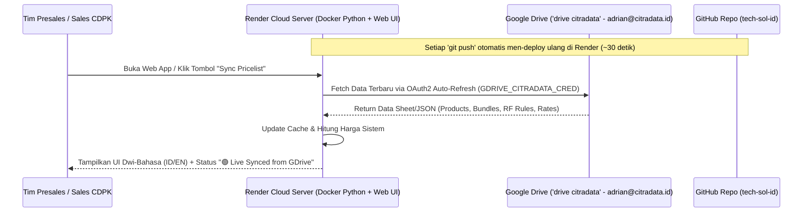

# PRD — CDPK System Planner (PRD-New)

> **Nama Aplikasi Resmi:** **CDPK System Planner** *(Solution Sizing, RF Simulation & Commercial Suite)*  
> **Pemilik / Entitas:** PT Citradata Purnakharisma (CDPK) — Authorized Distributor Motorola Solutions  
> **Target Bahasa:** Dwi-Bahasa / Bilingual (**Bahasa Indonesia `ID`** & **English `EN`**)  
> **AI Copilot Engine:** Multi-Model Selector (**Google Gemini 3.8 Flash** & **Google Gemini 3.8 Pro**)  
> **Target Arsitektur & Hosting:** GitHub (`tech-sol-id`) + Render Cloud (Singapore Region) + Google Drive Live API (`drive citradata`) — seragam dengan arsitektur [Grok x Slack](file:///Users/adriankansil/Documents/Grok%20x%20Slack/PRD.md)  
> **Referensi Baseline:** [PRD-legacy.md](file:///Users/adriankansil/Documents/Project%20Calculator%20-%20CDPK/PRD-legacy.md)

---

## 1. Visi Produk & Ringkasan Perubahan Utama (What's New)

**CDPK System Planner** mempertahankan seluruh kapabilitas teknis unggulan dari versi legacy (*RF Sizing Engine, DMR Capacity & Timeslot Planning, Multi-Factor Topology Decision, Intelligent Product Recommender, Presales Mandays WES Estimator, dan CloudRF-style Canvas Coverage Simulation*), sekaligus menghadirkan **6 lompatan pembaruan utama** yang telah dikonfirmasi:

1. **Verifikasi & Standardisasi Bank Knowledge (Data Accuracy & APAC Alignment):**
   - **Perbaikan Nama Repeater 50W:** Menstandarkan nama repeater standar 50W menjadi **`MOTOTRBO SLR 5300`** (sesuai kode resmi region APAC/Indonesia, menggantikan penamaan `SLR 5500` yang tercampur di kode legacy).
   - **Perbaikan Nama Repeater 1W In-Building/DAS:** Mengganti `MOTOTRBO CLR Series` di kategori Repeater menjadi **`MOTOTRBO SLR 1000`** (repeater kompak 1W–10W IP65 untuk indoor/DAS/outdoor, konsisten dengan tab Mandays).
   - **Auto-Allocate Kuantitas Radio di BoQ:** Menghapus status `"TBD"` pada baris radio di BoQ dengan mengalokasikan jumlah unit secara otomatis berdasarkan `userCount` dan rasio profil industri (misal: 85% Field Radio, 10% Vehicle/Security, 5% Supervisor Smart Radio) yang tetap bisa diedit langsung oleh user.
   - **2 Mode Export BoQ:** Menyediakan pilihan ekspor **`Technical BoQ`** (hanya spesifikasi & kuantitas tanpa harga) dan **`Commercial Quotation`** (lengkap dengan Harga Satuan, Sub-item Sistem, Diskon, PPN, & Kurs IDR/USD).
2. **Modul Baru: Perhitungan Harga Sistem & Perangkat Komposit (System & Bundle Pricing Configurator):**
   - Kemampuan merakit suatu **Sistem / Perangkat Utama** yang terdiri dari beberapa *sub-item* komponen (*Parent-Child BOM* — contoh: *1 Set Site Repeater System SLR 5300* otomatis menghitung Repeater, Duplexer, Antena, Kabel Coaxial per meter, Konektor, Lightning Arrester, UPS, dan Lisensi).
   - Kalkulasi finansial menyeluruh: *Base Pricelist (IDR & USD)*, *Kurs Konversi Dinamis*, *Margin / Markup*, *Diskon per Item atau Global*, *Pajak (PPN 11%/12%)*, serta *Biaya Jasa / Instalasi & Mandays*.
3. **Modul Baru: Multi-Model AI Copilot (`Gemini 3.8 Flash` & `Gemini 3.8 Pro`):**
   - Dilengkapi pemilih model AI (**Gemini 3.8 Flash** untuk respons instan sehari-hari dan **Gemini 3.8 Pro** untuk penalaran tender/arsitektur mendalam).
   - Kemampuan AI Copilot: (a) *Natural Language Prompt-to-Sizing & BoQ* (mengubah deskripsi proyek/RKS menjadi parameter sizing & daftar harga otomatis), (b) *Smart Budget & Spec Optimizer* (menyesuaikan kombinasi produk agar masuk target anggaran klien), dan (c) *Executive Proposal Narrative Generator* dalam bahasa `ID` / `EN`.
4. **Integrasi Real-Time dengan Cloud & Google Drive (`drive citradata` - `adrian@citradata.id`):**
   - Terhubung langsung ke Folder **`CDPK System Planner`** (`1OB_UaNyd65Ccb3lmdwJuw5raufCwhgbS`) dan Google Sheet **`Master Pricelist`** (`1Kp85v81JXeRC5ti-ZXYBChgrj2ztnnwrCHokI02LX6U`).
5. **Dukungan Dwi-Bahasa Penuh (Bilingual `ID` / `EN`):**
   - Seluruh antarmuka pengguna (UI), deskripsi katalog, catatan teknis otomatis, rekomendasi RF, AI Copilot, hingga dokumen hasil ekspor (**PDF, XLSX, DOCX**) mendukung pergantian bahasa instan antara **Bahasa Indonesia** dan **Bahasa Inggris**.
6. **Cloud Hosting & CI/CD Seragam dengan Proyek "Grok x Slack":**
   - Menggunakan repositori GitHub (`tech-sol-id`) yang terhubung otomatis (*Auto-Deploy on Push*) ke **Render Cloud (Region: Singapore)** dengan `Dockerfile` (Python 3.11 + FastAPI/Flask ringan sebagai API Proxy Google Drive & AI Copilot) serta *keep-alive* GitHub Actions / UptimeRobot.

---

## 2. Audit & Pembaruan Bank Knowledge (Knowledge Base Verification)

Berdasarkan audit terhadap `DMSC-I_Toolkit_v7_4.html` dan konfirmasi teknis, berikut adalah daftar ketetapan yang diterapkan pada sistem baru:

| Kategori | Status di Legacy | Ketetapan di Sistem Baru (PRD-New) |
| :--- | :--- | :--- |
| **Repeater In-Building 1W** | Tertulis `MOTOTRBO CLR Series` di Katalog, tapi `MOTOTRBO SLR 1000` di Mandays | Diubah & diseragamkan di seluruh modul menjadi **`MOTOTRBO SLR 1000`** (1W–10W In-Building/DAS Repeater). |
| **Repeater Standar 50W** | Tercampur antara `SLR 5300` dan `SLR 5500 Series` | Diseragamkan di seluruh modul menjadi **`MOTOTRBO SLR 5300`** (SKU resmi APAC/Indonesia). |
| **Repeater High Power 100W** | `MOTOTRBO SLR 8000` / `SLR 8000 High Power` | Diseragamkan menjadi **`MOTOTRBO SLR 8000`** (100W Continuous Duty). |
| **Kuantitas (Qty) Radio di BoQ** | Selalu tertulis `"TBD"` di tabel BoQ | **Auto-Allocate Qty Radio** berdasarkan input `userCount` (proporsi otomatis per role: *Field / Vehicle / Supervisor*) dengan kolom input yang bisa diedit manual oleh user sebelum ekspor. |
| **Mode Ekspor BoQ** | Hanya 1 mode tanpa harga | **2 Mode Ekspor:** (1) **Technical BoQ** (tanpa harga, untuk lampiran teknis) dan (2) **Commercial Quotation** (lengkap dengan rincian harga paket sistem, diskon, kurs IDR/USD, dan PPN). |
| **Bug Teknis Legacy** | Duplikasi 1.500 baris kode, variabel `effSites` undefined di `buildTopoSVG()`, dan tidak adanya key `mixed_inout` di path loss `terrainN` | Seluruh duplikasi dihapus; kode dipecah menjadi modul bersih; bug `buildTopoSVG()` dan `terrainN['mixed_inout'] = 3.5` diperbaiki. |

---

## 3. Spesifikasi Modul Baru: Perhitungan Harga Sistem & Perangkat (Cloud Pricing & Bundle Configurator)

### 3.1. Konsep Hierarki "System / Perangkat Komposit" (Parent-Child BOM)
Penawaran proyek disusun dalam bentuk **Paket Sistem / Perangkat** yang terdiri dari beberapa item komponen (*sub-items*) yang saling terhubung:

```mermaid
flowchart LR
    subgraph SystemBundle["Paket Sistem (Contoh: 1 Site Repeater Outdoor — MOTOTRBO SLR 5300)"]
        P1["[Main Unit] Repeater MOTOTRBO SLR 5300 VHF/UHF (1 Unit)"]
        P2["[RF Filtering] High-Isolation Cavity Duplexer (1 Unit)"]
        P3["[Antenna] Avanti Omni / Yagi Antenna + Mounting Bracket (1 Set)"]
        P4["[Feeder] Coaxial Cable 7/8 inch + Clamps (50 Meter — dinamis sesuai tinggi tower)"]
        P5["[Connectors] Connector N-Male + Jumper Cable 1/2 inch (1 Lot)"]
        P6["[Protection] Lightning Arrester + Grounding Kit (1 Set)"]
        P7["[License] MOTOTRBO System License (IPSC / CapPlus / CapMax) (1 Lisensi)"]
        P8["[Power] Online UPS + Battery Backup / Power Supply (1 Set)"]
    end
    SystemBundle --> CalcPrice["Kalkulasi Harga Otomatis per Site & Total Proyek"]
```



### 3.2. Fitur Utama Modul Kalkulator Harga (Pricing & Quotation Builder)
1. **Sinkronisasi Otomatis dari Sizing + Mode Custom Rakitan:**
   - **Auto-Generate dari Sizing:** Begitu tombol *Generate Solution* ditekan di tab Sizing, sistem langsung merakit paket Repeater Site (beserta sub-itemnya), mengalokasikan jumlah Radio Handheld/Mobile sesuai jumlah user, menambahkan Dispatcher/Gateway, Backhaul, dan Mandays ke dalam tabel **BoQ & Pricing**.
   - **Custom Bundle & Item Builder:** User juga dapat menambahkan paket sistem lain dari katalog (misal: merakit *Paket CCTV Avigilon AI NVR + Kamera H6A + PoE Switch* atau *Paket Radio Tambahan*), meng-expand/collapse sub-item, mengubah kuantitas per komponen, atau menambah item custom.
2. **Dukungan Multi-Mata Uang (IDR & USD) & Kurs Konversi:**
   - Harga dasar di Google Drive dapat berupa `USD` atau `IDR`.
   - Tersedia pengaturan **Kurs USD $\rightarrow$ IDR** (otomatis dari sheet konfigurasi GDrive atau dioverride manual di layar) sehingga seluruh penawaran dapat disajikan dalam **100% IDR**, **100% USD**, atau **Dual-Currency**.
3. **Kontrol Margin, Diskon, & Pajak (PPN):**
   - Mendukung pengaturan **Markup / Margin (%)**, **Diskon per Item / Diskon Global (%)**, dan **PPN (11% / 12% atau Exclude Tax)**.
   - Integrasi langsung dengan hasil **Mandays (WES)** untuk menghitung biaya *Installation, Programming, Testing & Commissioning* (`Total MD × Rate per Manday`).
4. **2 Mode Ekspor Dokumen (PDF, XLSX, DOCX):**
   - **Mode 1 — Technical BoQ:** Hanya menampilkan *Kategori, Model/Spesifikasi (beserta sub-item), Unit, Qty, dan Keterangan Teknis* (tanpa kolom harga).
   - **Mode 2 — Commercial Quotation / BoQ:** Menampilkan *Kategori, Model/Spesifikasi, Unit, Qty, Unit Price, Total Price, Subtotal, Discount, PPN, dan Grand Total* lengkap dengan syarat & ketentuan komersial.

---

## 4. Arsitektur Cloud Hosting & Integrasi Google Drive (Mengikuti Pola "Grok x Slack")

Berdasarkan pemeriksaan pada proyek **[Grok x Slack](file:///Users/adriankansil/Documents/Grok%20x%20Slack/PRD.md)** (`render.yaml`, `Dockerfile`, `gdrive_engine.py`, dan `.github/workflows/sync_drive.yml`), aplikasi ini akan menggunakan infrastruktur yang **100% seragam dan terbukti stabil**:



### 4.1. Pengaturan Hosting & Push Update (`Render + GitHub + Docker`)
1. **Repositori GitHub (`tech-sol-id`):**
   - Kode aplikasi disimpan di repositori GitHub organisasi `tech-sol-id`.
   - Setiap kali Anda meminta perubahan fitur atau tampilan, kita cukup melakukan `git commit && git push origin main`, dan Render akan langsung mem-build serta men-deploy versi baru secara otomatis.
2. **Container Runtime (`Dockerfile` + `render.yaml`):**
   - Menggunakan `python:3.11-slim` pada port `7860` di region `singapore` (sama persis dengan `cdpk-grok-slack-bot`).
   - Backend ringan berbasis Python (`FastAPI` / `Flask`) bertugas melayani:
     - **Frontend Web App** (Modular JS + Tailwind + Alpine.js).
     - **Endpoint `/api/pricing/sync` & `/api/knowledge`:** Menghubungi Google Drive API menggunakan kredensial `GDRIVE_CITRADATA_CRED` (dengan auto-refresh token persis seperti `gdrive_engine.py` di Grok x Slack) sehingga token OAuth Anda aman di sisi server dan tidak terekspos ke browser publik.
   - Dilengkapi workflow `.github/workflows/keep_alive.yml` agar layanan web di Render selalu siap diakses 24/7 tanpa jeda *cold-start*.

### 4.2. Struktur Folder & File Master di Google Drive (`drive citradata`)
Telah terhubung ke akun **`drive citradata` (`adrian@citradata.id`)** pada resource resmi berikut:
- **Folder Utama:** `CDPK System Planner` (`1OB_UaNyd65Ccb3lmdwJuw5raufCwhgbS`) — [Buka Folder](https://drive.google.com/drive/folders/1OB_UaNyd65Ccb3lmdwJuw5raufCwhgbS)
- **File Master Spreadsheet:** `Master Pricelist` (`1Kp85v81JXeRC5ti-ZXYBChgrj2ztnnwrCHokI02LX6U`) — [Buka Google Sheet](https://docs.google.com/spreadsheets/d/1Kp85v81JXeRC5ti-ZXYBChgrj2ztnnwrCHokI02LX6U/edit)

File `Master Pricelist` akan diisi otomatis dengan struktur 4 Tab Sheet yang siap diedit kapan saja oleh tim CDPK:
1. **`Products_Catalog`:** Daftar lengkap produk (SKU, Kategori, Series, Nama Model—dengan `MOTOTRBO SLR 5300` & `MOTOTRBO SLR 1000` yang sudah dikoreksi, Deskripsi `ID` & `EN`, Fitur `ID` & `EN`, BestFor `ID` & `EN`, Mata Uang `USD`/`IDR`, `Base_Price`, `Default_Markup_Pct`, `Unit`).
2. **`System_Bundles`:** Daftar paket sistem komposit (misal: *Paket Repeater Site Outdoor VHF/UHF*, *Paket Repeater Indoor DAS SLR 1000*, *Paket Dispatcher Control Room*, *Paket Solar Power Off-Grid*, *Paket CCTV AI NVR*) beserta daftar komponen sub-item dan rumus kuantitasnya.
3. **`Industry_RF_Params`:** Parameter teknis 19 kategori industri dan 8 jenis terrain (sehingga jika tim engineering ingin mengubah base radius atau alokasi rasio radio per industri, cukup edit dari Google Sheet).
4. **`Commercial_Config`:** Parameter komersial global (`USD_IDR_RATE`, `VAT_PPN_PCT`, `MANDAY_RATE_IDR`, `VALIDITY_DAYS`, info kontak & rekening/footer penawaran).

---

## 5. Spesifikasi Dwi-Bahasa (Bilingual `ID` & `EN`)

1. **Instant Language Toggle (`🇮🇩 ID` | `🇬🇧 EN`) di Navbar:**
   - Mengubah seluruh label form, navigasi tab, kartu hasil analisis teknis, rincian RF & kapasitas, tabel BoQ/Pricing, Mandays WES, hingga keterangan di simulasi Coverage Canvas secara real-time.
2. **Bilingual Dynamic Text Engine:**
   - Seluruh kalimat kesimpulan teknis otomatis (*Technical Summary*, *Special Recommendations*, *Power & UPS Calculation*, *Dead Zone Analysis*, dan *Timeline Recommendation*) dihasilkan dalam bahasa yang sedang dipilih.
3. **Bilingual Document Export (PDF, XLSX, DOCX):**
   - Dokumen **Technical BoQ**, **Commercial Quotation**, **Mandays WES Report**, dan **RF Coverage Simulation Report** otomatis dicetak dalam Bahasa Indonesia atau Bahasa Inggris sesuai pilihan user.

---

## 6. Struktur Direktori Proyek Baru (`Project Calculator - CDPK`)

```text
Project Calculator - CDPK/
├── legacy/
│   └── DMSC-I_Toolkit_v7_4.html      # File asli (dipertahankan sebagai arsip referensi)
├── PRD-legacy.md                     # Dokumentasi bedah tuntas aplikasi legacy
├── PRD-New.md                        # Dokumen spesifikasi sistem baru ini
├── Dockerfile                        # Konfigurasi container untuk Render Cloud (Port 7860)
├── render.yaml                       # Blueprint deployment Render (Singapore region)
├── requirements.txt                  # Dependency Python (FastAPI/Flask, requests, openpyxl, dll)
├── .github/workflows/
│   └── keep_alive.yml                # Cron pinger agar server Render aktif 24/7
├── server/
│   ├── app.py                        # Main web server & API endpoint
│   └── gdrive_sync.py                # Engine OAuth2 & Live Reader Google Drive ('drive citradata')
├── data/
│   └── default_knowledge.json        # Fallback cache lokal (30+ produk, paket sistem, & aturan RF)
└── static/
    ├── index.html                    # Main App Shell (Clean, Modular, Bilingual)
    ├── css/
    │   └── styles.css                # Glassmorphism UI & Print/Canvas Styling
    └── js/
        ├── i18n.js                   # Kamus Bahasa Indonesia (ID) & English (EN)
        ├── rf_sizing_engine.js       # Engine RF Geometry, DMR Capacity, & Topology Decision
        ├── pricing_bundle_engine.js  # Engine Kalkulator Harga Sistem, Sub-item, & Auto-Qty BoQ
        ├── mandays_wes_engine.js     # Engine Presales Mandays (WES Method)
        ├── coverage_sim_engine.js    # Engine HTML5 Canvas Propagation & Dead Zone
        ├── export_engine.js          # Generator PDF, XLSX, PNG, & DOCX (Technical & Commercial)
        └── main.js                   # Alpine.js Root Controller & State Integration
```
