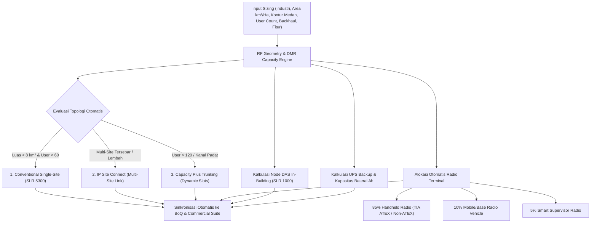
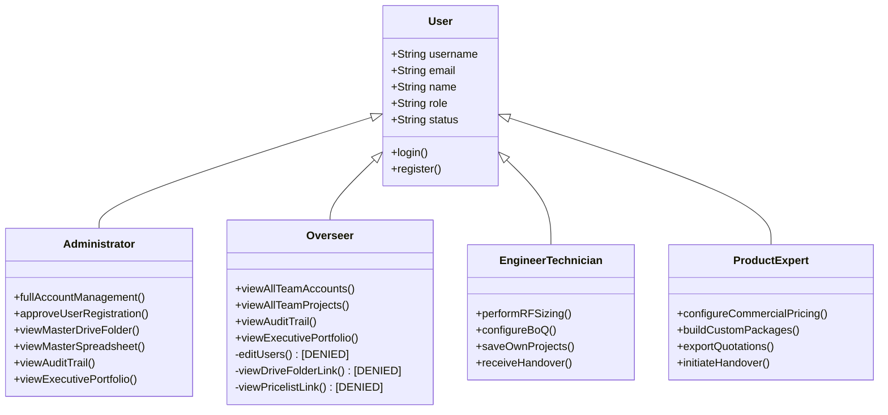
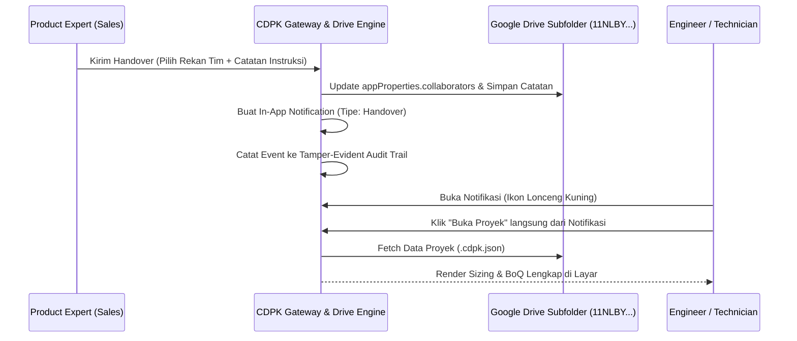

# PRD — CDPK System Planner (PRD-New v8.6.0)

> **Nama Aplikasi Resmi:** **CDPK System Planner** *(DMR System, RFoF Distributed Antenna System & Open Multi-Brand Video Security / CCTV Surveillance — Solution Sizing, RF Simulation, Commercial Suite & Enterprise Team Collaboration)*  
> **Pemilik / Entitas:** PT Citradata Purnakharisma (CDPK) — Authorized Distributor Motorola Solutions, Pelco, Avigilon & FMTCS Fiber DAS  
> **Versi Saat Ini:** `8.6.0 (Enterprise Production Build)`  
> **Target Bahasa:** Dwi-Bahasa Penuh / Bilingual (**Bahasa Indonesia `ID`** & **English `EN`**)  
> **AI Copilot Engine:** Multi-Model AI Selector (**Google Gemini 3.8 Flash** & **Google Gemini 3.8 Pro**)  
> **Arsitektur & Cloud Hosting:** GitHub (`tech-sol-id`) + Render Cloud Container (Singapore Region) + Google Drive Live API (`drive citradata`)  
> **Kebijakan Keamanan:** [Strict Security Policy & Threat Modeling (AGENTS.md)](file:///Users/adriankansil/Documents/Project%20Calculator%20-%20CDPK/AGENTS.md)  
> **Dokumentasi Terkait:** [PRD-legacy.md](file:///Users/adriankansil/Documents/Project%20Calculator%20-%20CDPK/PRD-legacy.md) | [USER_GUIDE.md](file:///Users/adriankansil/Documents/Project%20Calculator%20-%20CDPK/USER_GUIDE.md)

---

## 1. Visi Produk & Ringkasan Eksekutif

**CDPK System Planner** adalah platform rekayasa sistem komunikasi radio **DMR System**, **RFoF Distributed Antenna System (`RFoF DAS by FMTCS`)**, dan **Video Security / CCTV Surveillance (Open Multi-Brand)** terintegrasi (*end-to-end*) dalam satu pintu login (*Single Sign-On*), yang memadukan perhitungan teknis propagasi RF, perencanaan kapasitas talkgroup & timeslot, desain topologi Fiber DAS multi-lantai (Digital DOMU/DORU & Analog AOMU/AORU), sizing throughput & storage NVR CCTV, audit interoperabilitas cross-brand, perakitan paket solusi komposit (*Parent-Child BOM*), kalkulasi komersial presisi dengan asisten kurs valas multi-tiered, kolaborasi tim lintas-divisi (*Product Expert* & *Engineer / Technician*), serta tata kelola pengawasan eksekutif (*Overseer* & *Administrator*) berbasis Google Drive Cloud.

### Pilar Utama Platform (Versi 8.6.0):
1. **Triple-Workspace Engineering (`📡 DMR System`, `🏢 RFoF Distributed Antenna System`, & `📹 Video Security & CCTV Surveillance`):**
   - **Workspace 1 (`📡 DMR System`):** Sizing RF geometrik, rekomendasi topologi bertingkat (Conventional, IP Site Connect, Capacity Plus Trunking), kalkulasi node DAS kompak (SLR 1000), estimasi mandays (WES Method), dan simulasi canvas propagasi CloudRF-style.
   - **Workspace 2 (`🏢 RFoF Distributed Antenna System` — `RFoF DAS by FMTCS`):** 6 modul lengkap rekayasa Fiber DAS multi-zona untuk gedung bertingkat, basement, terowongan, dan data center (BoQ & Topologi Multi-Lantai SVG, Link Budget & Planner Antena, Konversi RF & VSWR, Cakupan Outdoor Okumura-Hata, Commissioning & Laporan SAT PDF, serta Katalog 17 Perangkat FMTCS).
   - **Workspace 3 (`📹 Video Security & CCTV Surveillance`):** Sizing sistem kamera pengawas industri multi-brand (Pelco, Avigilon, Ava, Milesight, VIGI by TP-Link, Axis, Hanwha, Hikvision, Dahua, Bosch, Uniview), kalkulator standar forensik DORI (EN 62676-4), kalkulator drop tegangan kabel Cat6 loop resistance, universal NVR bandwidth & storage retention sizing, PoE power budget, serta mesin audit blocker/reminder interoperabilitas VMS.
   - **Two-Way Cross-Workspace Bridges:** Injeksi 1-klik dari hasil sizing DMR ke RFoF DAS (`🏢 Perluas ke RFoF DAS by FMTCS`) serta penggabungan 1-klik seluruh komponen CCTV dan FMTCS ke Master BoQ DMR (`📥 Kirim ke BoQ Utama (DMR)`).
2. **Modular Product & System Configurator:** Menghitung paket repeater base station (SLR 5300, SLR 8000), radio terminal portabel (R7, P6620i, P8668i), paket turnkey Fiber DAS FMTCS (`SYS-DAS-FMTCS-DIGITAL` & `SYS-DAS-FMTCS-ANALOG`), armada kamera pengawas IP/AI, serta konfigurator kustom dinamis dengan pemilihan lisensi (*Licenses*) dan aksesoris (*Accessories*) per produk.
3. **Enterprise Zero-Trust Security & Gatekeeping:**
   - Halaman depan terisolasi 100% (*Zero DOM Leakage*) dengan perlindungan CSS `x-cloak` dan otentikasi wajib sebelum akses workspace.
   - Pembatasan domain korporat ketat: hanya `@citradata.id` dan `@techsolutions.id`.
   - Mekanisme persetujuan wajib (*Admin Pending Approval*) untuk setiap pengguna baru.
4. **Empat Tingkat Peran Pengguna (Four-Tier RBAC) & Akses Terbuka Estimator:**
   - **👑 Administrator:** Kontrol penuh pengguna, persetujuan akun, akses link folder master Drive & master pricelist, akses penuh **Estimator & Komersial BoQ** (edit harga satuan, rasio desain, COGS, dan margin), jejak audit, dan ringkasan portofolio.
   - **👁️ Overseer:** Mode pantau & evaluasi eksekutif. Dapat melihat seluruh akun tim (view-only), membuka seluruh dokumen arsip tim, meninjau jejak audit (*audit trail*), memantau kepatuhan margin eksekutif, serta memiliki akses terbuka penuh ke Estimator & Komersial BoQ.
   - **💼 Product Expert:** Fokus pada penawaran komersial, konfigurasi paket produk, akses penuh Estimator Komersial BoQ, margin & diskon, ekspor quotation, serta handover proyek ke tim engineering.
   - **🛠️ Engineer / Technician:** Fokus pada rekayasa teknis, sizing RF, kalkulasi Link Budget, DORI, PoE drop voltage, SAT RFoF DAS, estimasi mandays, kuantitas teknis BoQ (tanpa kolom harga/margin finansial), penyimpanan berkas, dan penerimaan handover.
5. **Kolaborasi Handover & Notifikasi Terpusat:**
   - Serah terima proyek resmi antardivisi dengan riwayat handover (*handover history*) yang tersimpan pada metadata berkas Google Drive, ditambah fitur Token & QR Code Handoff Offline (`FMTCSDAS1-...`).
   - Pusat notifikasi in-app (ikon lonceng kuning dengan penghitung belum dibaca) untuk alert penugasan dan jalan pintas pembukaan proyek.
6. **Executive Portfolio & Margin Guardrails:**
   - Bar ringkasan eksekutif: total pipeline nilai proyek (IDR), rata-rata margin tim, kepatuhan guardrail, dan jumlah proyek berisiko.
   - Kebijakan Guardrail Margin: Peringatan visual otomatis `⚠️ <15%` pada seluruh tabel BoQ jika margin berada di bawah standar perusahaan.
7. **Jejak Audit Terdesentralisasi (Tamper-Evident Audit Trail):**
   - Pencatatan otomatis aktivitas login, mutasi pengguna, penyimpanan proyek, pembukaan berkas, serah terima, serta ekspor dokumen PDF/Excel.
8. **Global Multi-Currency ($ USD & Rp IDR) and Exchange Rate (FX) Advisory Assistant:**
   - **Prinsip Non-Destruktif:** Harga resmi IDR pada Master Pricelist (seperti MOTOTRBO R2, SLR 5300, baterai, kabel) bersifat permanen dan tidak terpengaruh oleh fluktuasi kurs harian.
   - **Arsitektur Tiga Tingkat (Multi-Tiered Rate Sources):** Mode Finance SSOT (`Commercial_Config`), Mode Live Spot FX (`open.er-api.com` dengan caching lokal 4 jam), dan Mode Project Manual Override (+1%, +2%, +5% buffer).
   - **Mode Tampilan Global:** Fleksibilitas memilih Dual Currency (IDR + USD), Hanya IDR, atau Hanya USD.
   - **Klausul Disclaimer Resmi Finance:** Wajib tercantum pada banner antarmuka, proposal AI Copilot, footer ekspor PDF penawaran komersial, dan lembar Excel BoQ.

---

## 2. Modul Rekayasa Teknis (Engineering & Calculation Engines)



### 2.1. Parameter Sizing & Standardisasi Regional APAC
- **Repeater 50W Utama:** Diseragamkan menjadi **`MOTOTRBO SLR 5300`** (menggantikan kode non-resmi legacy).
- **Repeater 1W–10W DAS / In-Building:** Diseragamkan menjadi **`MOTOTRBO SLR 1000`** (IP65 Compact Repeater).
- **Repeater 100W Continuous Duty:** **`MOTOTRBO SLR 8000`**.
- **Radio Portabel Standar:** **`MOTOTRBO R7 Series`** (Display/Non-Display, TIA ATEX opsional) dan **`XiR P6620i / P8668i`**.
- **Kuantitas Radio Dinamis:** Status `"TBD"` dihapus permanen; kuantitas dialokasikan proporsional berdasarkan rasio profil industri dengan input yang dapat disesuaikan pengguna.

### 2.2. Presales Mandays WES Estimator
- Menghitung hari kerja teknis (*Mandays*) berdasarkan kompleksitas medan (*Low, Medium, High*), jumlah site, node DAS, jumlah radio yang diprogram, serta integrasi dispatcher/CCTV.
- Biaya mandays langsung terhubung dengan rate standar perusahaan (`Rp 3.500.000 / Manday`) dan terintegrasi otomatis ke baris jasa engineering pada BoQ.

### 2.3. Simulasi Propagasi Canvas RF
- Mensimulasikan estimasi cakupan sinyal (*Strong, Fair, Weak, Dead Zone*) pada canvas HTML5 interaktif berdasarkan koordinat geografis, daya pancar repeater (Watt), gain antena (dBi), dan redaman kabel/feeder (dB).
- Mendukung ekspor tangkapan peta simulasi ke format PNG beresolusi tinggi.

### 2.4. Workspace 2: RFoF Distributed Antenna System (`RFoF DAS by FMTCS`)
Workspace khusus untuk perancangan sistem distribusi antena berbasis *RF over Fiber* pada gedung bertingkat, basement, terowongan tambang, dan fasilitas data center (`static/js/das_engine.js`):
1. **Tab 1 — BoQ & Topologi Multi-Lantai:**
   - Pilihan Arsitektur: **Digital RFoF** (`DOMU400C.RI` + `DORU400CH.RI`, rasio hingga 1:32) atau **Analog RFoF** (`AOMU400C.RI` + `AORU400CH.RI`, rasio 1:8).
   - Pilihan Topologi Fiber: **Star (Point-to-Multipoint)**, **Cascade (Daisy-Chain)**, atau **Redundant Ring**.
   - Perencanaan Zona Lantai: Input jumlah antena indoor (`ANTI400R.M`) per lantai/basement dan kuantitas repeater/radio/antena outdoor, menghasilkan kalkulasi otomatis perangkat aktif (OMU, ORU), perangkat pasif (`FMTCS-CFH8`, `FMTCS-DJF8`, `DSGQ400C.RI`, `UDSS400C`, `PD400R.M`, `CP400R.M`), kabel koaksial 1/2", konektor N-K, dan patchcord fiber, disertai **Diagram Topologi SVG Interaktif**.
   - **Tombol Reset 1-Klik (`🔄 Reset DAS (0)`, `🔄 Reset BoQ (0)`, `🔄 Reset Lantai (0)`) & `📋 Contoh Standar`:** Memungkinkan pengguna mengosongkan seluruh zona lantai, repeater, radio, harga kustom, dan kuantitas BoQ menjadi `0` dalam 1 klik untuk memulai proyek baru dari nol, atau memuat kembali contoh standar 4 lantai.
   - **Akses Terbuka Estimator & BoQ Komersial (`Admin`, `Overseer`, `Product Expert`):** Pengguna dengan peran **Administrator**, **Overseer**, dan **Product Expert** dapat mengedit langsung **Harga Satuan (Unit Price)** tiap item di tabel BoQ DAS, mengatur **Rasio Desain Estimator** (`Antena/ORU`, `ORU/OMU`, `Rasio Splitter`, `Rasio Coupler`, `Kabel Coax m/Antena`), memilih mata uang (`IDR`/`USD`), serta memantau **COGS** dan **Margin %** dengan guardrail $\ge 15\%$.
   - **Jembatan Dua Arah (`Two-Way Bridge`):** Tombol `🏢 Perluas ke RFoF DAS by FMTCS` dari hasil sizing DMR dan tombol `📥 Gabungkan ke Master BoQ DMR` untuk menyatukan seluruh perangkat FMTCS ke Master BoQ DMR.
2. **Tab 2 — Link Budget & Planner Antena:**
   - Kalkulasi rantai sinyal (*Signal Chain*) tahap demi tahap dari output ORU (40 dBm / 10W) melewati redaman kabel koaksial, splitter, dan gain antena hingga menghasilkan **EIRP**, **Status Kesehatan Sinyal**, **Radius Cakupan (m)**, dan **Jumlah Antena per Lantai** yang dapat ditransfer langsung ke BoQ DAS.
3. **Tab 3 — Konversi RF & VSWR:**
   - Kalkulator rekayasa instan 4-arah: **Daya RF** ($\text{dBm} \leftrightarrow \text{mW} \leftrightarrow \text{W} \leftrightarrow \text{dBW}$), **Gain/Loss** ($\text{dB} \leftrightarrow \text{Rasio Daya/Tegangan}$), **VSWR & Return Loss** ($\text{VSWR} \leftrightarrow \text{RL dB} \leftrightarrow \Gamma \leftrightarrow \text{Reflected Power \%}$), dan **Field Strength** ($\text{dB}\mu\text{V} \leftrightarrow \text{dBm @ } 50\,\Omega$).
4. **Tab 4 — Cakupan Outdoor (Model Empiris Okumura-Hata):**
   - Evaluasi link budget Uplink & Downlink dan jarak jangkauan maksimum (km) pada 6 profil lingkungan (*Urban Small/Medium*, *Urban Metropolitan*, *Suburban*, *Open/Rural*).
5. **Tab 5 — Commissioning & Laporan SAT PDF:**
   - Formulir inspeksi penerimaan lapangan (*Site Acceptance Test*) per titik antena (VSWR $\le 1.50$, Tx Power $\ge 8.0\text{ dBm}$, Rx Level $\ge -85.0\text{ dBm}$, dan Kualitas Panggilan) dengan fitur **Ekspor Laporan Resmi Commissioning PDF** siap tanda tangan.
6. **Tab 6 — Katalog Perangkat FMTCS:**
   - Referensi spesifikasi teknis lengkap untuk 17 SKU perangkat aktif, pasif, antena, dan aksesoris resmi FMTCS Fiber DAS.

---

## 3. Modul Komersial & Konfigurator Paket Sistem

### 3.1. Konsep Parent-Child Bill of Materials (BOM)
Setiap paket sistem menghitung komponen utama beserta seluruh sub-item pembentuknya secara otomatis:
- **Paket Repeater Base Station:** Repeater, cavity duplexer (termasuk cavity lab tuning), antena omni/yagi, kabel feeder coaxial 7/8" atau 1/2" per meter tower, lightning arrester grounding kit, rack cabinet 19", dan online UPS.
- **Paket Terminal Radio:** Unit HT, baterai cadangan IMPRES, charger multi-unit 6-way atau single-unit, remote speaker microphone (RSM), earpiece, swivel carry case, dan lisensi enkripsi AES-256.

### 3.2. Konfigurator Paket Kustom Dinamis (Tab 7)
Memungkinkan pengguna merakit produk apa pun dari katalog dengan arsitektur:
1. **Pilihan Produk Utama:** Dropdown pencarian cerdas (misal: `SLR5300`, `R7`, `XiR P6620i`).
2. **Kategori Lisensi (Licenses):** Menyesuaikan otomatis dengan produk yang dipilih (misal: *IP Site Connect License*, *Capacity Plus Single/Multi-Site*, *AES-256 Encryption License*, *Mandown / GPS License*).
3. **Kategori Aksesoris (Accessories):** Menyesuaikan otomatis dengan produk yang dipilih (misal: *IMPRES 2900mAh Battery*, *6-Way Multi-Unit Charger*, *Heavy Duty Noise-Cancelling RSM*, *Cavity Duplexer UHF*).
4. **Kalkulasi Finansial Paket:** COGS Modal, Target Margin %, Harga Jual Klien, dan Tombol Transfer langsung ke BoQ Utama.

### 3.3. Kontrol Komersial & Mode Ekspor
- **Multi-Currency:** Mendukung mata uang **IDR (Rupiah)** dan **USD (US Dollar)** dengan kurs konversi dinamis.
- **Pajak & Diskon:** Diskon per item atau global (%) serta opsi PPN (11%, 12%, atau Non-PKP 0%).
- **2 Format Ekspor Dokumen:**
  1. **Technical BoQ (PDF / Excel):** Menampilkan rincian teknis, spesifikasi, sub-item BOM, dan kuantitas tanpa kolom harga komersial (untuk lampiran teknis tender).
  2. **Commercial Quotation (PDF / Excel):** Menampilkan struktur harga lengkap, diskon, PPN, grand total, syarat pembayaran, rekening resmi, dan masa berlaku penawaran.

---

## 4. Keamanan Sistem & Kontrol Akses (Security & RBAC)

Sesuai standar [CDPK Security Policy (AGENTS.md)](file:///Users/adriankansil/Documents/Project%20Calculator%20-%20CDPK/AGENTS.md):



### 4.1. Kebijakan Keamanan Otentikasi
1. **Domain Whitelisting:** Hanya alamat email dengan domain `@citradata.id` dan `@techsolutions.id` yang diizinkan masuk atau mendaftar. Domain publik (`@gmail.com`, `@yahoo.com`) ditolak secara absolut.
2. **Pending Approval Protocol:** Akun yang didaftarkan mandiri otomatis berstatus `pending` dan terkunci hingga diverifikasi dan disetujui secara eksplisit oleh Administrator.
3. **Kriptografi Password:** Menggunakan hashing **PBKDF2 dengan SHA-256** dan *unique cryptographic salt* (100.000 iterasi). Verifikasi password menggunakan `secrets.compare_digest` untuk mencegah serangan timing attack.
4. **Keamanan Sesi:** Menggunakan token acak 256-bit (`secrets.token_urlsafe(32)`) dengan masa berlaku terkelola.
5. **HTTP Security Headers:**
   - `X-Content-Type-Options: nosniff`
   - `X-Frame-Options: SAMEORIGIN`
   - `Referrer-Policy: strict-origin-when-cross-origin`

---

## 5. Kolaborasi Tim, Handover & Notifikasi

### 5.1. Alur Serah Terima Proyek (Handover Workflow)
Fitur handover dirancang khusus untuk memfasilitasi kerja sama antara divisi *Product Expert* (Sales) dan *Engineer / Technician* (Presales):



1. **Inisiasi Handover:** Pembuat proyek dapat memilih 1 atau lebih rekan tim aktif, menyertakan catatan khusus (misal: *"Mohon bantu verifikasi tinggi tower dan survei link backhaul"*).
2. **Metadata Drive:** Daftar kolaborator disimpan pada properti Google Drive `appProperties.collaborators`.
3. **Pusat Notifikasi (Yellow Bell):**
   - Terletak di bilah atas aplikasi dengan badge jumlah pesan belum dibaca.
   - Memberikan notifikasi instan dan tombol aksi langsung untuk memuat proyek terkait tanpa harus mencari di arsip.

---

## 6. Tata Kelola Eksekutif: Portofolio, Guardrail & Jejak Audit

### 6.1. Ringkasan Portofolio Eksekutif (Executive Portfolio Summary)
Tersedia bagi **Administrator** dan **Overseer** di bagian atas modal Arsip Proyek:
- **Total Pipeline Nilai Proyek:** Akumulasi total nominal penawaran seluruh proyek tim (format Rupiah IDR).
- **Rata-rata Margin Tim:** Indikator kesehatan profitabilitas tim penjualan.
- **Kepatuhan Guardrail:** Menghitung jumlah proyek yang memenuhi batas aman margin perusahaan ($\ge 15\%$).
- **Perlu Perhatian Margin:** Mendeteksi otomatis proyek dengan margin tipis ($< 15\%$) yang memerlukan peninjauan khusus manajemen.

### 6.2. Kebijakan Guardrail Margin (Margin Guardrail Policy)
- **Standar Ambang Batas:** Minimum **15.0%**.
- **Indikator Visual Peringatan:**
  - **Tabel BoQ (Tab 2):** Input target margin berubah warna menjadi oranye dan memunculkan banner peringatan guardrail.
  - **Konfigurator Paket Kustom (Tab 7):** Slider margin memunculkan pill alert `⚠️ Guardrail Margin: Di bawah standar (<15%)`.
  - **Daftar Berkas Arsip:** Setiap berkas proyek menampilkan badge `⚠️ Margin: X% (<15%)` atau `✓ Margin: X%`.

### 6.3. Jejak Audit Terdesentralisasi (Tamper-Evident Audit Trail)
- Modul backend: `server/audit.py` | Penyimpanan: `data/audit_log.json`.
- Event yang dicatat secara permanen:
  - `login` / `logout` / `register`: Akses autentikasi (Google Workspace / Kredensial) beserta alamat IP.
  - `user_mgmt`: Penambahan akun, perubahan profil, toggle status, persetujuan/penolakan, promosi, dan reset password.
  - `save_project`: Penyimpanan berkas proyek baru atau revisi ke Google Drive.
  - `load_project`: Pembukaan kembali berkas proyek dari Google Drive.
  - `handover`: Serah terima proyek antardivisi beserta daftar penerima dan catatan.
  - `export_pdf` / `export_xlsx`: Pengunduhan dokumen resmi penawaran komersial dan BoQ.

---

## 7. Multi-Model AI Copilot (Google Gemini)

Terhubung ke endpoint AI resmi dengan pemilih model:
1. **Google Gemini 3.8 Flash:** Dirancang untuk inferensi cepat (sub-detik), formulasi parameter sizing dari deskripsi kebutuhan klien, dan penyusunan draf BoQ instan.
2. **Google Gemini 3.8 Pro:** Dirancang untuk penalaran kompleks, analisis tender RKS teknis yang rumit, optimalisasi anggaran (*budget constraints*), dan pembuatan narasi proposal eksekutif komprehensif.

Fitur AI Copilot:
- *Natural Language Prompt-to-Sizing*: Mengubah kalimat klien menjadi konfigurasi radio, repeater, dan topologi otomatis.
- *Bilingual Proposal Narrator*: Menghasilkan bab narasi metodologi teknis penawaran dalam Bahasa Indonesia atau Inggris.
- *State Syncing*: Membaca *state* kalkulasi aktif saat ini sehingga saran AI selalu relevan dengan konteks layar pengguna.

---

## 8. Arsitektur Integrasi Google Drive & Cloud Hosting

### 8.1. Sumber Daya Google Drive Terhubung (`drive citradata`)
- **Master Google Drive Folder:** `1OB_UaNyd65Ccb3lmdwJuw5raufCwhgbS` (Folder Utama CDPK System Planner).
- **Sub-folder Arsip Output:** `11NLBY5EAPLb4q753r1TRVKgYRe0JpO8W` (*Kalkulasi & Penawaran Tim*).
- **Sub-folder Markdown Knowledge Bank:** `1-rv_4obDjZ3ZqxSQIvx6u-bYfUnH1zMV` (`_Markdown_Knowledge_Base`, termasuk 9 dokumen teknis `FMTCS_DAS_01` s/d `FMTCS_DAS_09`).
- **Master Spreadsheet Pricelist:** `1Kp85v81JXeRC5ti-ZXYBChgrj2ztnnwrCHokI02LX6U` (mencakup tab `Products_Catalog`, `RFoF_DAS_FMTCS`, `System_Bundles`, `Custom_Builder_Rules`, `Environment_Multipliers`, `System_Config`, `Team_Users`, `Saved_Projects_Log`, dan `Audit_Trail_Log`).
- **Token OAuth2 Terisolasi:** Disimpan di sisi server (`GDRIVE_CITRADATA_CRED`) dengan auto-refresh tanpa melibatkan browser klien.

### 8.2. Spesifikasi Deployment Render Cloud
- **Docker Base Image:** `python:3.11-slim`.
- **Container Port:** `7860`.
- **Region:** `singapore`.
- **Healthcheck Endpoint:** `/health` (mendukung `GET` dan `HEAD`).
- **Keep-Alive:** Workflow GitHub Actions berjalan otomatis berkala untuk mencegah *cold-start sleep* pada tier non-dedicated.

---

## 9. Desain Antarmuka Responsif Mobile & Tablet

Aplikasi dirancang agar dapat diakses optimal di lapangan (*field survey*):
- **Cross-Platform:** Kompatibel penuh dengan smartphone dan tablet (Apple iOS Safari, iPadOS, dan Android Chrome).
- **Responsive Layout:**
  - Header dengan layout fleksibel membungkus logo, Workspace Switcher (`📡 DMR System` | `🏢 RFoF Distributed Antenna System` dengan `whitespace-nowrap`), pemilih bahasa, pusat notifikasi, info pengguna, dan tombol aksi tanpa terpotong (*no horizontal scroll overflow*).
  - Sentuhan ramah jari (*touch target $\ge 44\text{px}$*).
  - Tabel BoQ dengan pembungkus *horizontal scroll* halus untuk layar sempit.
  - Modal dan drawer dengan tinggi adaptif (`max-h-[92vh]`) dan penutup sentuhan luar (*click outside*).

---

## 10. Struktur Direktori Proyek (Production v8.5.0)

```text
Project Calculator - CDPK/
├── Dockerfile                        # Konfigurasi container Render Cloud (Port 7860)
├── render.yaml                       # Blueprint Render (Region: Singapore)
├── requirements.txt                  # Dependensi Python
├── AGENTS.md                         # Dokumen Kebijakan Keamanan & Tata Kelola Agen
├── PRD-New.md                        # Dokumen Spesifikasi Produk (Dokumen Ini)
├── PRD-legacy.md                     # Arsip spesifikasi versi legacy
├── USER_GUIDE.md                     # Panduan Lengkap Operasional Pengguna
├── README.md                         # Informasi Repositori & Petunjuk Setup
├── app.py                            # Gateway API & Server Aplikasi Utama
├── server/
│   ├── auth.py                       # Autentikasi PBKDF2, Sesi, Google OAuth, & RBAC
│   ├── audit.py                      # Engine Tamper-Evident Audit Trail Logger
│   ├── gdrive_sync.py                # Integrasi Google Drive API & Spreadsheet Reader (Tab RFoF_DAS_FMTCS)
│   ├── knowledge_search.py           # Hybrid RAG Search Engine (DMR + FMTCS Fiber DAS)
│   ├── knowledge_sync.py             # Sinkronisasi Knowledge Bank Markdown ke Google Drive
│   ├── notifications.py              # In-App Notification Center
│   └── ai_copilot.py                 # Multi-Model Gemini 3.8 Flash & Pro Engine
├── data/
│   ├── audit_log.json                # Log aktivitas audit trail
│   ├── default_knowledge.json        # Cache lokal katalog produk DMR, Avigilon & FMTCS Fiber DAS
│   ├── knowledge_base/               # Dokumen Markdown RAG (termasuk FMTCS_DAS_01..09.md)
│   ├── notifications.json            # Database notifikasi pengguna
│   └── users.json                    # Cache data akun pengguna lokal
└── static/
    ├── index.html                    # Single Page Application Shell (Dual-Workspace Bilingual UI)
    ├── service-worker.js             # PWA Service Worker (cdpk-pwa-v8.5.0)
    └── js/
        ├── app_core.js               # Alpine.js Controller, State Management & Two-Way DMR<->DAS Bridge
        ├── das_engine.js             # Engine Rekayasa RFoF Distributed Antenna System (FMTCS)
        ├── i18n.js                   # Kamus Bahasa Indonesia (ID) & English (EN)
```

---

## 11. Modul Rekayasa Lanjutan: Optical Link Budget, IM3, Erlang-B & Daya Cadangan (v8.5.2)

### 11.1. Optical Link Budget Calculator (OMU ↔ ORU)
- **Dasar Rekayasa:** Menghitung *Path Loss* optik pada jaringan C-RAN serat optik Single-Mode (ITU-T G.652) antara Master OMU (DOMU/AOMU) dan Remote Unit (DORU/AORU).
- **Formula & Variabel:**
  - Redaman Serat Optik: $0.35\text{ dB/km}$ (@ $1310\text{ nm}$) atau $0.22\text{ dB/km}$ (@ $1550\text{ nm}$).
  - Konektor FC/APC: $0.5\text{ dB}$ per mated pair.
  - Sambungan Fusion Splice: $0.1\text{ dB}$ per sambungan.
  - Redaman Splitter Optik: $1:2$ ($3.5\text{ dB}$), $1:4$ ($7.2\text{ dB}$), $1:8$ ($10.5\text{ dB}$).
  - Safety / Aging Margin: $3.0\text{ dB}$.
  - Tingkat Sinyal Diterima ($P_{\text{rx}}$): $P_{\text{tx}} - \text{Total Loss}$.
  - Net Margin (dBo): $P_{\text{rx}} - \text{Sensitivitas Receiver}$ (default: $-15\text{ dBm}$).
- **Status Verdict:**
  - `Pass`: Sinyal optik prima ($> 3\text{ dBo}$).
  - `Warning`: Margin tipis ($0 \le \text{Margin} < 3\text{ dBo}$) atau daya saturasi ($P_{\text{rx}} > -1\text{ dBm}$).
  - `Fail`: Redaman melampaui ambang batas sensitivitas receiver.

### 11.2. Validator Intermodulasi (IM3) & Cavity Combiner
- **Tujuan:** Mencegah interferensi antar-repeater saat digabungkan ke satu antena outdoor melalui Combiner `BCFH400-8` dan Multicoupler `PDJF400-8`.
- **Algoritma:**
  - Evaluasi Spasi Kanal: Memvalidasi $\Delta f = |f_{i+1} - f_i| \ge 150\text{ kHz}$ (spasi minimum cavity filter).
  - Evaluasi Produk Intermodulasi Orde Ke-3: Menghitung $f_{\text{IM3}} = 2f_a - f_b$ untuk seluruh pasangan frekuensi aktif.
  - Deteksi Tabrakan Korban (*Victim Collision*): Memeriksa apakah $f_{\text{IM3}}$ jatuh pada frekuensi kerja repeater aktif dalam toleransi raster $\pm 12.5\text{ kHz}$.
  - Status: `Clean` (Aman), `Spacing Warning` (Spasi rapat), `IM3 Collision` (Tabrakan frekuensi).

### 11.3. Kalkulator Kapasitas Trafik Erlang-B (Trunking Advisor)
- **Tujuan:** Memberikan rekomendasi ilmiah kapan pelanggan cukup menggunakan arsitektur Konvensional / IP Site Connect (IPSC) vs harus beralih ke MOTOTRBO Capacity Plus (Single-Site / Multi-Site Trunking).
- **Formula Rekursif Erlang-B:**
  $$B(c, A) = \frac{A \cdot B(c-1, A)}{c + A \cdot B(c-1, A)}, \quad B(0, A) = 1$$
  - $A = \frac{N \times \text{BHCA} \times T}{3600}$ (Trafik ditawarkan dalam Erlang).
  - $c = \text{Jumlah Repeater} \times 2$ (Slot suara TDMA).
- **Rekomendasi Dinamis:**
  - Jika $B(c, A) \le \text{Target GoS}$ (default 2%): Arsitektur IPSC konvensional dinyatakan memadai.
  - Jika $B(c, A) > \text{Target GoS}$: Sistem merekomendasikan migrasi ke MOTOTRBO Capacity Plus lengkap dengan jumlah repeater minimum yang dibutuhkan.

### 11.4. Kalkulator Sizing Daya Cadangan & Solar Panel Off-Grid
- **Beban Arus Repeater:** Konsumsi DC saat transmit ($150\text{W}$ untuk RF $50\text{W}$) dan standby/idle ($18\text{W}$) berdasarkan *Duty Cycle* (10%, 20%, 30%).
- **Kebutuhan Kapasitas Baterai (Ah):**
  $$\text{Ah} = \frac{P_{\text{avg}} \times \text{Backup Hours}}{\eta_{\text{inverter}} \times V_{\text{batt}} \times \text{DoD}}$$
  (DoD: 80% untuk LiFePO4, 50% untuk VRLA Lead-Acid).
- **Dimensi Panel Surya Off-Grid ($W_p$):**
  $$W_p = \frac{E_{\text{daily}} \times 1.30}{\text{Peak Sun Hours (PSH)}}$$
  (Default PSH Indonesia: 4.2 jam; efisiensi sistem cadangan 70%).

### 11.5. Sinkronisasi Otomatis Mandays & Turnkey Proposal PDF
- Estimasi Mandays (WES) di Tab 4 secara otomatis mendeteksi keberadaan komponen RFoF DAS FMTCS dan menyertakan fase pekerjaan:
  - *Penarikan kabel serat optik & Fusion Splicing OTDR*.
  - *Instalasi kabel koaksial 1/2" & Pemasangan Antena Plafon (`ANTI400R.M`)*.
  - *Pemasangan Master Unit DOMU/AOMU & Remote Unit DORU/AORU*.
- Ekspor PDF Penawaran Komersial dan BoQ Teknis otomatis mencantumkan ringkasan topologi RFoF DAS dan rincian multi-lantai di bawah kotak ringkasan DMR.

---

## 12. Usulan Roadmap Pengembangan Sistem Masa Depan (Proposed Future Roadmap)

Berdasarkan keselarasan portofolio produk PT Citradata Purnakharisma (Motorola Solutions, FMTCS Fiber DAS, Pelco Video Security, Avigilon Unity/Alta, dan i.safe MOBILE HazLoc), berikut adalah 4 pilar usulan pengembangan terencana:

### 12.1. Fase 1: Modul CCTV Surveillance & NVR Planner (Open Multi-Brand: Pelco, Avigilon, Milesight, VIGI & Third-Party)
* **Status:** Selesai Diimplementasikan Penuh (*Completed in v8.6.0*).
* **Engine Core:** `static/js/cctv_engine.js` (Exposes `window.CDPK_CCTV_ENGINE`).
* **Objektif:** Mengintegrasikan perencanaan sistem kamera pengawas industri (CCTV Surveillance) ke dalam ekosistem CDPK System Planner dengan arsitektur **Open Multi-Brand & Universal ONVIF**. Selain mendukung katalog bawaan *flagship* CDPK (**Pelco**, **Avigilon**, dan **Ava Security** dari Motorola Solutions), sistem juga terbuka untuk brand pihak ketiga (**Milesight**, **VIGI by TP-Link**, **Axis**, **Hanwha Vision**, **Hikvision**, **Dahua**, **Bosch**, **Uniview**) maupun kamera kustom berbasis standar industri Profile S/T/M. Hal ini memastikan solusi turnkey CDPK dapat menyatukan Radio Komunikasi DMR, RFoF DAS, dan Video Security dari berbagai merk dalam satu proposal utuh.
* **Fitur Utama:**
  1. **Organisasi Katalog 2 Bagian & Multi-Filter Fleksibel:**
     * **Section 1 (Partner Resmi Flagship PT CDPK - Prioritas Distribusi):** **Pelco**, **Avigilon Unity**, dan **Ava Alta Cloud** (Motorola Solutions) yang didukung garansi manufaktur resmi, ketersediaan suku cadang lokal, dan integrasi native tanpa celah.
     * **Section 2 (Brand Pihak Ketiga & Terbuka via Universal ONVIF):** **Milesight**, **VIGI (by TP-Link)**, **Axis**, **Hanwha Vision**, **Hikvision**, **Dahua**, **Bosch**, **Uniview**, serta **Generic ONVIF / Custom Camera**.
     * **Bilah Multi-Filter:** Filter interaktif berdasarkan Kategori Kerjasama (*Tier: Official vs Third-Party*), Merk (*12 Brand*), Tipe / Form Factor (*Bullet, Dome, PTZ, Multi-Sensor, Thermal, Hazloc Ex*), Proteksi Lingkungan (*Outdoor IP66/67/IK10, Indoor, ATEX Explosion-Proof Zone 1/21, Marine AISI 316L*), dan Resolusi Sensor (*1080p, 4MP, 5MP, 4K, 12MP, Thermal*).
  2. **Mesin Audit Interoperabilitas & Kompatibilitas Multi-Brand:**
     * Evaluasi otomatis armada kamera terhadap VMS dan infrastruktur jaringan.
     * **Blocker Analitik AI Avigilon:** Kamera pihak ketiga (*Milesight, VIGI, Axis, Hikvision, Dahua*) yang dihubungkan ke VMS Avigilon Unity hanya dapat menyalurkan video mentah via ONVIF tanpa metadata analitik. Sistem otomatis memicu *Blocker Alert* dan tombol aksi 1-klik memasukkan **Avigilon AI Appliance (VMA-AIE2-8P)** ke BoQ aksesoris.
     * **Kebutuhan Lisensi Channel VMS:** Otomatis mendeteksi dan menghitung lisensi resmi pihak ketiga (*AVG-COMM-CAM-LIC* pada Avigilon Unity atau *PEL-VX-1C-COMM* pada Pelco VideoXpert).
     * **Peringatan Stuttering SmartCodec Proprietary:** Memperingatkan potensi frame stuttering saat fitur dinamis proprietary (*Hikvision H.265+, Dahua Smart H.265, VIGI Smart Coding, Milesight H.265+, Axis Zipstream*) direkam ke VMS cross-brand, dilengkapi tombol 1-klik beralih ke H.265 standar.
     * **Blocker Alokasi Daya PoE Ultra 802.3bt:** Mencegah tripping switch standar jika terdapat kamera PTZ/Thermal/ExSite berdaya tinggi (60W–90W).
  3. **Kalkulator Standar DORI & Panjang Fokus Lensa (EN 62676-4):**
     * Menghitung Horizontal FoV (HFoV), Scene Width ($W_s$), dan densitas piksel ($PPM = \frac{W_{\text{pixel}} \times f}{d \times w_s}$) pada jarak target $d$ meter.
     * Klasifikasi otomatis 4 tingkatan standar internasional **EN 62676-4**: **Detection** ($\ge 25\text{ PPM}$), **Observation** ($\ge 62\text{ PPM}$), **Recognition** ($\ge 125\text{ PPM}$), dan **Identification** ($\ge 250\text{ PPM}$), beserta jarak jangkauan maksimum per tingkatan.
  4. **Kalkulator Jarak Kabel Cat6 & PoE Voltage Drop:**
     * Menghitung resistansi loop kabel ($0.165\,\Omega/\text{m}$ untuk Cat6, $0.188\,\Omega/\text{m}$ untuk Cat5e), penurunan tegangan DC ($V_{\text{drop}} = I \times R_{\text{loop}}$), tegangan bersih di terminal kamera ($V_{\text{camera}} = V_{\text{PSE}} - V_{\text{drop}}$), dan rugi daya kabel ($P_{\text{loss}} = I^2 \times R_{\text{loop}}$).
     * Rekomendasi otomatis perangkat transmisi: **Industrial Long-Reach PoE Extender** untuk jarak $101 - 250\text{ m}$, atau **Industrial PoE Fiber Media Converter** untuk jarak $> 250\text{ m}$ (melampaui batas fisik tembaga), serta alarm undervoltage jika $V_{\text{camera}} < V_{\text{min}}$.
  5. **Universal Bandwidth & Storage NVR Estimator:**
     * Menghitung throughput *network bandwidth* (Mbps) dan total *storage* (TB) berdasarkan jumlah kamera gabungan multi-brand, resolusi (1080p 2MP, 4MP, 4K 8MP, 12MP, Bispectral Thermal), frame rate (10/15/25/30 fps), format kompresi (H.264, H.265, SmartCodec / Zipstream / WiseStream / HDSM, atau custom bitrate manual Mbps), dan masa retensi rekaman (30, 60, 90 hari).
     * Rekomendasi kapasitas NVR/VMS Server (kompatibel VMS multi-brand Pelco VideoXpert / Avigilon Unity / Generic NVR), konfigurasi RAID (RAID 5 / RAID 6), dan *storage overhead safety factor* 20%.
  6. **Kalkulator Daya PoE & Industrial Network Switch Sizing:**
     * Menghitung total daya konsumsi PoE (IEEE 802.3af 15.4W, 802.3at PoE+ 30W, dan 802.3bt PoE++ 60W/90W untuk kamera PTZ luar ruang dengan wiper & heater).
      * Rekomendasi jumlah port (8/16/24/48 ports) dan tipe Industrial Core/Distribution PoE Switch yang dibutuhkan.
   7. **Bridge ke Master BoQ CDPK:**
      * Seluruh item kamera (baik Pelco, Avigilon, maupun brand pihak ketiga), lisensi VMS (Channel Base License / VMS Extension), NVR, switch PoE, dan aksesoris sistem (AI Appliance, PoE Extender, FMC SFP) langsung di-inject ke BoQ gabungan bersama DMR & DAS dengan perhitungan live FX, COGS, dan margin guardrail $\ge 15\%$.

### 12.2. Modul Global Multi-Currency ($ USD & Rp IDR) and Exchange Rate (FX) Advisory Assistant
* **Status:** Selesai Diimplementasikan Penuh (*Completed in v8.6.0*).
* **Engine Core:** `server/fx_service.py` & `static/js/app_core.js`.
* **Objektif:** Menyediakan asisten penasihat nilai tukar valuta asing (FX) yang aman, akurat, dan non-destruktif untuk tender dan proyek yang melibatkan komponen berdenominasi Dollar AS ($ USD), tanpa mengganggu harga resmi Rupiah (IDR) yang telah ditetapkan oleh Finance pada Master Pricelist.
* **Fitur Utama:**
  1. **Prinsip Non-Destruktif (Zero Master Pricelist Disruption):**
     * Seluruh harga tetap dalam Rupiah (IDR) pada Master Pricelist (seperti MOTOTRBO R2, repeater SLR 5300, baterai, kabel) bersifat permanen dan tidak terpengaruh oleh fluktuasi kurs pasar.
     * Mesin FX hanya mengonversi perangkat yang bersumber dari modal Dollar (USD), item impor luar negeri, atau sebagai panduan estimasi dual currency (Rupiah & Dollar) bagi tim tender.
  2. **Arsitektur Tiga Tingkat (Multi-Tiered Rate Sources):**
     * **Mode 1 — Finance SSOT (Default):** Mengambil kurs resmi yang ditetapkan Divisi Finance dari Google Sheets tab `Commercial_Config` (`usd_to_idr`).
     * **Mode 2 — Live Spot FX (Advisory):** Mengambil kurs pasar riil secara otomatis via public feed (`open.er-api.com` / `exchangerate-api.com`) dengan sistem failover dan local cache 4 jam (`data/fx_cache.json`). Dilengkapi deteksi varians nominal dan persentase terhadap kurs Finance.
     * **Mode 3 — Project Manual Override:** Pengguna dapat memasukkan angka kurs khusus untuk tender tertentu (misal: Rp 16.500) dilengkapi tombol pintas buffer cepat (**`+1% Buffer`**, **`+2% Buffer`**, **`+5% Buffer`**). Perubahan ini terisolasi pada sesi proyek aktif dan tidak mengubah spreadsheet master Finance.
  3. **Modal Kontrol FX & Simulasi Stress Testing:**
     * Pilihan tampilan global: **Dual Currency (IDR + USD)**, **Hanya Rupiah (IDR)**, atau **Hanya Dollar (USD)**.
     * Tabel Sensitivitas & Stress Testing: Menampilkan proyeksi dampak finansial otomatis jika kurs bergerak naik atau turun (-5% s/d +10%) terhadap nilai total proyek.
  4. **Klausul Disclaimer Resmi Finance (Bilingual):**
     * Wajib tercantum pada banner antarmuka, proposal AI Copilot, footer ekspor PDF penawaran komersial, dan lembar Excel BoQ.
     * Bahasa Indonesia: *"Seluruh estimasi nilai konversi valas (USD/IDR) bersifat indikatif teknis. Nilai tukar resmi, harga modal (COGS), dan klausul penawaran komersial wajib dikonfirmasi secara tertulis ke Divisi Finance PT Citradata Purnakharisma sebelum penerbitan quotation resmi atau penandatanganan Kontrak/PO."*

### 12.3. Fase 2: Formal Commercial Quotation Engine (Surat Penawaran Resmi PT CDPK)
* **Objektif:** Menjembatani hasil kalkulasi engineering langsung menjadi dokumen komersial legal siap kirim ke meja direksi atau tim procurement pelanggan.
* **Fitur Utama:**
  1. **Template Kop Surat Resmi CDPK:** Penomoran otomatis (`CDPK/QUO/{YYYY}/{MM}/{NO}`), identitas pelanggan/proyek, dan syarat ketentuan komersial (Terms of Payment, Franco Jakarta, Waktu Pengiriman, Masa Garansi, dan Masa Berlaku Penawaran 14/30 hari).
  2. **Tanda Tangan Digital & Stempel:** Otorisasi tanda tangan digital Sales Manager / Direktur yang diproteksi PIN keamanan.
  3. **Ekspor PDF Penawaran Resmi:** Menghasilkan dokumen penawaran harga formal siap kirim (lengkap dengan lampiran BoQ dan Term of Reference).

### 12.4. Fase 3: Modul Kepatuhan ATEX & HazLoc Intrinsically Safe (IS Compliance Checker)
* **Objektif:** Memastikan seluruh perangkat komunikasi di area berbahaya (Hazardous Locations) memenuhi regulasi keselamatan ledakan untuk tender sektor Oil & Gas (Pertamina, Medco), Petrokimia, dan Pertambangan.
* **Fitur Utama:**
  1. **HazLoc Zone Matrix Validator:** Validasi kecocokan perangkat terhadap zona bahaya: Zone 0, 1, 2 (Gas) atau Zone 20, 21, 22 (Debu), Gas Group (IIC/IIB/IIA), dan Kelas Suhu (T1–T6) atau Class I/II/III Div 1/2.
  2. **IS Accessory Safety Guard:** Peringatan otomatis jika aksesoris non-IS (baterai standar atau mic non-ATEX) dipasangkan pada radio bersertifikasi ATEX (MOTOTRBO ATEX / i.safe MOBILE IS541.1/IS941.1).
  3. **Cetak HazLoc Compliance Sheet:** Lembar verifikasi kepatuhan sertifikasi ATEX/IECEx untuk lampiran dokumen tender resmi.

### 12.5. Fase 4: Visual 2D Indoor Floor Plan Heatmap & Outdoor GIS Coverage Map
* **Objektif:** Menyajikan simulasi visual interaktif sebaran propagasi sinyal RF dan sudut pandang kamera untuk meyakinkan pemilik gedung dan konsultan proyek.
* **Fitur Utama:**
  1. **Indoor Floor Plan Heatmap Canvas (RFoF DAS & CCTV):**
     * Penempatan di Tab 2 modul RFoF DAS FMTCS.
     * Pengunggahan denah lantai arsitektur (JPG/PNG).
     * Penempatan antena indoor FMTCS `ANTI400R.M` dan ORU secara drag-and-drop.
     * Rendering gradien warna panas RSSI (dBm) untuk mendeteksi *dead spot* secara visual.
     * Proyeksi kerucut sudut pandang (Field of View / FoV cone) untuk kamera CCTV Pelco/Avigilon.
  2. **Outdoor GIS Coverage Map (DMR Base Station):**
     * Penempatan di Tab 2 modul DMR System Planner.
     * Peta geografis satelit / OpenStreetMap berbasis Leaflet.js.
     * Plotting koordinat GPS site repeater tower dengan proyeksi lingkaran radius jangkauan efektif (Okumura-Hata) di atas peta wilayah operasional klien.


