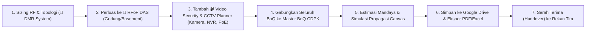
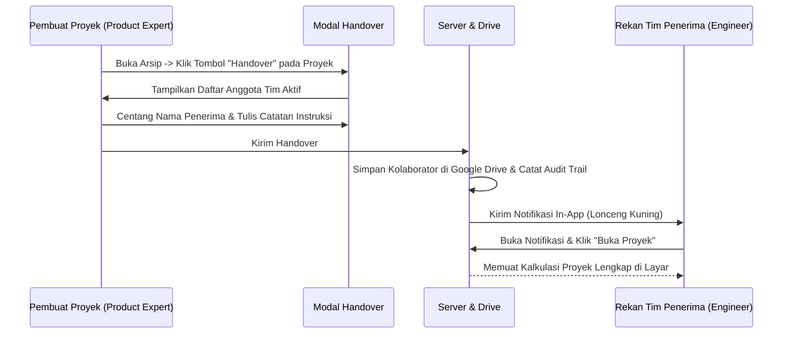

# Panduan Pengguna Resmi (User Guide)
## CDPK System Planner — Versi 8.6.0

> **Sistem:** CDPK System Planner *(DMR System, RFoF Distributed Antenna System & Open Multi-Brand Video Security / CCTV Surveillance — Solution Sizing, RF Simulation, Commercial Suite & Enterprise Team Collaboration)*  
> **Distributor Resmi:** PT Citradata Purnakharisma (CDPK) — Authorized Distributor Motorola Solutions, Pelco, Avigilon & FMTCS Fiber DAS  
> **Akses Web Produksi:** [https://cdpk-system-planner.onrender.com/](https://cdpk-system-planner.onrender.com/)  
> **Bahasa:** Dwi-Bahasa (**🇮🇩 Bahasa Indonesia** & **🇬🇧 English**)  

---

## Daftar Isi
1. [Akses Sistem & Panduan Masuk (Login)](#1-akses-sistem--panduan-masuk-login)
2. [Tingkatan Peran Pengguna & Hak Akses Estimator (RBAC)](#2-tingkatan-peran-pengguna--hak-akses-estimator-rbac)
3. [Alur Kerja Rekayasa & Workspace Switcher (DMR ↔ RFoF DAS ↔ Video Security)](#3-alur-kerja-rekayasa--workspace-switcher-dmr--rfof-das--video-security)
4. [Panduan Modul 1: Sizing RF & Penentuan Topologi (DMR System)](#4-panduan-modul-1-sizing-rf--penentuan-topologi)
5. [Panduan Modul 2: BoQ & Konfigurasi Finansial](#5-panduan-modul-2-boq--konfigurasi-finansial)
6. [Panduan Modul 3: Katalog Produk & Spesifikasi](#6-panduan-modul-3-katalog-produk--spesifikasi)
7. [Panduan Modul 4: Estimasi Jasa & Mandays (Metode WES)](#7-panduan-modul-4-estimasi-jasa--mandays-metode-wes)
8. [Panduan Modul 5: Simulasi Propagasi Canvas RF](#8-panduan-modul-5-simulasi-propagasi-canvas-rf)
9. [Panduan Modul 6: Multi-Model AI Copilot](#9-panduan-modul-6-multi-model-ai-copilot)
10. [Panduan Modul 7: Kalkulator Produk & Sistem Kustom](#10-panduan-modul-7-kalkulator-produk--sistem-kustom)
11. [Panduan Workspace 2: RFoF Distributed Antenna System (`RFoF DAS by FMTCS`)](#11-panduan-workspace-2-rfof-distributed-antenna-system-rfof-das-by-fmtcs)
    - [Cara Me-Reset BoQ & Input RFoF DAS (`🔄 Reset DAS (0)`)](#cara-me-reset-boq--input-rfof-das--reset-das-0)
    - [Akses Estimator & BoQ Komersial (`Admin`, `Overseer`, `Product Expert`)](#akses-estimator--boq-komersial-admin-overseer-product-expert)
12. [Panduan Workspace 3: Video Security & CCTV Surveillance Planner (Open Multi-Brand)](#12-panduan-workspace-3-video-security--cctv-surveillance-planner-open-multi-brand)
    - [Arsitektur Multi-Brand & Custom Camera Builder](#arsitektur-multi-brand--custom-camera-builder)
    - [Tab 1: Estimator Bandwidth Throughput & Kapasitas Storage NVR](#tab-1-estimator-bandwidth-throughput--kapasitas-storage-nvr)
    - [Tab 2: Sizing Konsumsi Daya PoE & Industrial Switch](#tab-2-sizing-konsumsi-daya-poe--industrial-switch)
    - [Tab 3: Estimator BoQ Video Security & Two-Way Bridge ke Master BoQ](#tab-3-estimator-boq-video-security--two-way-bridge-ke-master-boq)
    - [Tab 4: Katalog Kamera & Hardware Bawaan](#tab-4-katalog-kamera--hardware-bawaan)
13. [Kolaborasi Tim & Fitur Handover Proyek](#13-kolaborasi-tim--fitur-handover-proyek)
14. [Pusat Notifikasi & Serah Terima Tugas](#14-pusat-notifikasi--serah-terima-tugas)
15. [Penyimpanan Cloud & Dashboard Arsip Google Drive](#15-penyimpanan-cloud--dashboard-arsip-google-drive)
16. [Panduan Khusus Eksekutif (Administrator & Overseer)](#16-panduan-khusus-eksekutif-administrator--overseer)
    - [Ringkasan Portofolio Eksekutif](#ringkasan-portofolio-eksekutif)
    - [Kebijakan Guardrail Margin (< 15%)](#kebijakan-guardrail-margin--15)
    - [Jejak Audit Aktivitas (Audit Trail)](#jejak-audit-aktivitas-audit-trail)
17. [Penggunaan pada Smartphone & Tablet (PWA & Versi Mobile)](#17-penggunaan-pada-smartphone--tablet-pwa--versi-mobile)
18. [Panduan Fitur Rekayasa Lanjutan: Optical Link Budget, IM3, Erlang-B & Daya Cadangan (v8.5.2)](#18-panduan-fitur-rekayasa-lanjutan-optical-link-budget-im3-erlang-b--daya-cadangan-v852)
    - [18.1. Kalkulator Optical Link Budget (OMU ↔ ORU)](#181-kalkulator-optical-link-budget-omu--oru)
    - [18.2. Validator Intermodulasi (IM3) & Frequency Combiner](#182-validator-intermodulasi-im3--frequency-combiner)
    - [18.3. Kalkulator Kapasitas Trafik Erlang-B & Trunking Advisor](#183-kalkulator-kapasitas-trafik-erlang-b--trunking-advisor)
    - [18.4. Kalkulator Sizing Daya Cadangan & Solar Panel Off-Grid](#184-kalkulator-sizing-daya-cadangan--solar-panel-off-grid)
19. [Panduan Global Multi-Currency ($ USD & Rp IDR) and Exchange Rate (FX) Advisory Assistant (v8.6.0)](#19-panduan-global-multi-currency--usd--rp-idr-and-exchange-rate-fx-advisory-assistant-v860)

---

## 1. Akses Sistem & Panduan Masuk (Login)

### 1.1. Alamat Resmi Aplikasi
Buka peramban (*web browser*) Anda ke: **[https://cdpk-system-planner.onrender.com/](https://cdpk-system-planner.onrender.com/)**

> [!IMPORTANT]
> Halaman depan aplikasi diproteksi secara ketat. Sebelum berhasil masuk (*login*), seluruh lembar kalkulator dan data proyek terisolasi dan tidak dapat diakses publik.

### 1.2. Opsi Masuk (Login)
1. **Jalur Utama: Masuk / Daftar 1-Klik dengan Google Workspace:**
   - Klik tombol **"Masuk / Daftar dengan Google Workspace"**.
   - Pilih akun email resmi perusahaan Anda:
     - `@citradata.id` (Karyawan PT Citradata Purnakharisma)
     - `@techsolutions.id` (Tim Engineering & Mitra Resmi)
   - *Keunggulan:* Tidak memerlukan password manual, terenkripsi penuh oleh Google Identity Services.
   - *Catatan:* Email publik seperti `@gmail.com` atau domain di luar whitelist akan ditolak otomatis oleh sistem keamanan.
2. **Jalur Sekunder: Masuk dengan Kredensial Khusus (Username & Password):**
   - Khusus akun lokal yang didaftarkan secara manual oleh Administrator.
   - Masukkan *Username / Email* dan *Password*, lalu klik **"Masuk dengan Password"**.

### 1.3. Pendaftaran Pengguna Baru & Penetapan Role oleh Admin
Sistem menyediakan dua jalur orientasi anggota tim baru:
1. **Jalur Rekomendasi: Pre-Provisioning oleh Admin (Tanpa Password)**
   - Administrator mendaftarkan email resmi karyawan (`@citradata.id` / `@techsolutions.id`) dan langsung menetapkan perannya melalui panel *Kelola Pengguna Tim*.
   - Password manual tidak diperlukan. Status akun langsung **`🟢 Aktif`**.
   - Ketika karyawan tersebut login pertama kali via Google Workspace SSO, sistem langsung mengenali emailnya dan memberikan akses instan tanpa menunggu approval.
2. **Jalur Registrasi Mandiri (Self-Initiated Google SSO):**
   - Karyawan baru yang langsung menekan tombol Google Workspace SSO akan dicatat dalam antrean **`⏳ Pending Approval`**.
   - Administrator menerima notifikasi verifikasi pendaftar baru dan dapat **memilih peran yang diinginkan** (*Product Expert, Engineer / Technician, Overseer, atau Administrator*) langsung pada menu verifikasi sebelum menekan tombol **"Setujui & Aktifkan"**.
   - *Tips:* Pengguna baru yang memerlukan percepatan aktivasi akun cukup hubungi Admin.

### 1.4. Keamanan Kredensial Khusus & Manajemen Password Mandiri
Untuk menjamin keamanan tingkat enterprise, sistem menerapkan standar kriptografi ketat:
- **Lokasi & Enkripsi Kredensial:** Data akun disimpan pada server lokal (`data/users.json`) dan disinkronkan ke tab cloud `Team_Users` pada Master Google Sheet. Password asli **TIDAK PERNAH DISIMPAN DALAM TEKS BIASA (*plaintext*)**. Seluruh password dienkripsi menggunakan algoritma standar militer **PBKDF2-HMAC-SHA256 (100.000 putaran kalkulasi)** dengan *cryptographic salt* 128-bit unik untuk setiap akun.
- **Penyensoran Google Sheets:** Pada Google Sheet tab `Team_Users`, kolom Password (F) disamarkan penuh dengan karakter `●●●●●●●●`. Hanya nilai hash terenkripsi dan salt unik yang disimpan.
- **Fitur Ganti Password Mandiri:** Pengguna yang masuk (termasuk Administrator) dapat mengganti password kapan saja secara instan melalui tombol **"🔑 Ganti Password"** di bar navigasi atas.
- **Fitur Reset Password oleh Admin:** Administrator dapat mereset password anggota tim mana pun langsung melalui panel *Kelola Tim*.

### 1.5. Dukungan Dwibahasa Penuh (Full Bilingual Support ID/EN)
Aplikasi mendukung peralihan bahasa instan antara **Bahasa Indonesia (ID)** dan **English (EN)** melalui toggle di pojok kanan atas:
- **Cakupan Dwibahasa:** Seluruh elemen aplikasi, mulai dari formulir login, navigasi kedua workspace (`📡 DMR System` dan `🏢 RFoF Distributed Antenna System`), kalkulator sizing, BoQ komersial, simulasi RF & GIS heatmap, katalog produk, modul configurator mandiri, dialog kirim email, hingga panduan pengguna interaktif, merespons perubahan bahasa secara *real-time*.

---

## 2. Tingkatan Peran Pengguna & Hak Akses Estimator (RBAC)

Sistem membedakan hak akses berdasarkan 4 peran resmi:

| Peran | Simbol | Deskripsi & Hak Akses | Akses Estimator & Harga BoQ (DMR & RFoF DAS) | Akses Folder Master Cloud |
| :--- | :---: | :--- | :---: | :---: |
| **Administrator** | 👑 | Pemilik sistem dengan akses mutlak: mengelola seluruh akun tim, menyetujui pendaftaran, membuka link folder master Google Drive & Google Sheet pricelist (`Products_Catalog` & `RFoF_DAS_FMTCS`), serta meninjau seluruh arsip proyek, audit trail, dan portofolio. | **PENUH** (Edit Harga Satuan, Rasio Desain Estimator DAS, COGS, Margin & Diskon) | **YA** (Akses Penuh) |
| **Overseer** | 👁️ | Pemantau & Peninjau Eksekutif (Direksi, GM, Head of Department). Dapat melihat seluruh akun tim (*view-only*), membuka seluruh arsip proyek tim, meninjau jejak audit (*audit trail*), memantau kepatuhan margin eksekutif, serta mengevaluasi & mengubah simulasi harga/rasio pada BoQ & Estimator. | **PENUH** (Edit Harga Satuan, Rasio Desain Estimator DAS, COGS, Margin & Diskon) | **TIDAK** (Folder & Sheet Master disembunyikan) |
| **Product Expert** | 💼 | Tim penjualan & konsultan produk komersial. Fokus pada perakitan paket produk, optimasi harga penawaran klien, pengaturan diskon/margin, kustomisasi harga & rasio Estimator RFoF DAS, ekspor proposal, dan handover ke presales. | **PENUH** (Edit Harga Satuan, Rasio Desain Estimator DAS, COGS, Margin & Diskon) | **TIDAK** (Hanya arsip sendiri / yang dibagikan) |
| **Engineer / Technician** | 🛠️ | Tim teknis & presales rekayasa sistem. Fokus pada kalkulasi RF, topologi repeater, perencanaan zona antena RFoF DAS, Link Budget, Commissioning SAT PDF, estimasi mandays jasa, kuantitas teknis BoQ, dan penerimaan handover dari sales. | **TEKNIS SAJA** (Kuantitas & Spesifikasi terbuka; kolom Harga, COGS, dan Margin disembunyikan) | **TIDAK** (Hanya arsip sendiri / yang dibagikan) |

---

## 3. Alur Kerja Rekayasa & Workspace Switcher (DMR ↔ RFoF DAS ↔ Video Security)

Di bagian atas layar (serta di dalam menu laci *mobile*), tersedia **Workspace Switcher** untuk berpindah antar tiga modul utama secara instan:
- **`📡 DMR System`** — Workspace perencanaan sistem radio MOTOTRBO (Conventional, IP Site Connect, Capacity Plus), simulasi peta propagasi RF, estimasi mandays WES, dan Master BoQ.
- **`🏢 RFoF Distributed Antenna System`** — Workspace rekayasa sistem distribusi antena serat optik (**RFoF DAS by FMTCS**) untuk gedung bertingkat, basement, terowongan, dan kompleks industri.
- **`📹 Video Security & CCTV`** — Workspace perencanaan sistem pengawasan video & NVR multi-brand (Pelco, Avigilon, Axis, Hanwha, Hikvision, Dahua, Bosch, Uniview, Generic ONVIF), estimasi throughput bandwidth/storage, sizing daya PoE switch, dan integrasi Master BoQ.

---

## 4. Panduan Modul 1: Sizing RF & Penentuan Topologi

1. **Parameter Lingkungan & Industri:**
   - **Jenis Industri:** Pilih profil industri (Pertambangan, Minyak & Gas, Perkebunan Kelapa Sawit, Manufaktur, Pelabuhan, Rumah Sakit, dll.).
   - **Luas Area Cakupan:** Masukkan angka luas area operasional dalam satuan **km²** atau **Hektar (Ha)**.
   - **Kontur Medan (Terrain):** Pilih medan (*Flat, Rolling Hills, Mountainous, Dense Forest, Indoor Building*).
2. **Kebutuhan Pengguna & Fitur Khusus:**
   - **Jumlah Pengguna Radio Aktif (Users):** Masukkan estimasi total unit radio yang digunakan.
   - **Tinggi Tower Utama:** Tinggi antena repeater (standar 30–60 meter).
   - **Fitur Kritis:** Centang kebutuhan *ATEX Intrinsically Safe*, *Enkripsi Tingkat Tinggi (AES-256)*, *GPS Tracking*, *Man Down / Lone Worker*, dan *Integrasi Dispatcher Console*.
3. **Hasil Rekomendasi Otomatis:**
   - **Topologi:** Sistem otomatis memilihkan topologi optimal (*Conventional, IP Site Connect, atau Capacity Plus Trunking*).
   - **Repeater Base Station:** Menentukan jumlah site outdoor dan jumlah unit repeater standar 50W (**MOTOTRBO SLR 5300**).
   - **In-Building DAS Node:** Menghitung jumlah node penguat sinyal indoor kompak (**MOTOTRBO SLR 1000**).
   - **Alokasi Radio:** Membagi kuantitas radio HT (85%), radio kendaraan Mobile (10%), dan radio supervisor (5%).
   - **Daya & UPS:** Merekomendasikan kapasitas UPS (*VA*) dan kapasitas bank baterai (*Ah*) untuk ketahanan operasional sesuai jam backup yang dipilih.
4. **Fitur Reset Isian (Mulai Baru):**
   - Jika Anda ingin memulai rancangan kalkulasi baru atau mengembalikan parameter yang telah diubah ke konfigurasi standar, klik tombol **`🔄 Reset Isian`** pada bagian atas kartu *Parameter Teknis & Lingkungan Operasi* (di samping tombol *'✨ Isi dengan AI'*).
   - Seluruh isian teknis akan dikembalikan secara bersih ke konfigurasi baseline default awal, dan sistem secara otomatis memperbarui rekomendasi topologi, BoQ, serta simulasi propagasi.

---

## 5. Panduan Modul 2: BoQ & Konfigurasi Finansial

1. **Pilihan Mata Uang & Kurs:**
   - Pilih penawaran dalam **IDR (Rupiah)** atau **USD (Dollar)**.
   - Masukkan kurs konversi (default `Rp 16.200 / USD`).
2. **Target Margin Komersial & Kebijakan Guardrail:**
   - Masukkan persentase target margin penawaran.
   - **Peringatan Guardrail Margin:** Jika margin diatur di bawah **15.0%**, sistem akan memunculkan peringatan oranye `⚠️ Guardrail Margin Rendah (<15%)`. Proyek dengan margin rendah memerlukan persetujuan khusus Administrator / Overseer.
3. **Diskon & Pajak (PPN):**
   - Masukkan diskon komersial global jika ada (0–50%).
   - Pilih tarif PPN: **11%**, **12%**, atau **0% (Non-PKP / Bebas Pajak)**.
4. **Pilihan Mode Ekspor Dokumen:**
   - **Mode Technical BoQ:** Mencetak dokumen spesifikasi perangkat dan kuantitas rapi tanpa mencantumkan harga (untuk lampiran teknis tender).
   - **Mode Commercial Quotation:** Mencetak penawaran harga lengkap resmi beserta subtotal, diskon, PPN, dan grand total investasi.

---

## 6. Panduan Modul 3: Katalog Produk & Spesifikasi

- Menampilkan daftar produk resmi Motorola Solutions dan sistem keamanan Avigilon.
- Dilengkapi fitur **Pencarian Cerdas (Smart Search)** berdasarkan SKU, nama model, atau kata kunci (misal: `"ATEX"`, `"SLR5300"`, `"R7"`, `"IMPRES"`).
- Filter kategori cepat: *Repeater, Portable Radio (HT), Mobile Radio, Accessories, Dispatcher & Software, serta Video Security*.

---

## 7. Panduan Modul 4: Estimasi Jasa & Mandays (Metode WES)

- Menghitung hari kerja teknisi (*Work Breakdown Structure — Presales WES*):
  1. *Site Survey & Radio Propagation Testing*
  2. *Tower & Antenna Rigging Installation*
  3. *Repeater Programming & Duplexer Cavity Tuning*
  4. *Terminal Radio Programming & Fleetmap Alignment*
  5. *Dispatcher Console & Server Integration*
  6. *User Training, Testing, & Final Handover Commissioning*
- Pengguna dapat memilih tingkat kesulitan medan (*Low, Medium, High*) dan ukuran tim engineering.
- Hasil mandays otomatis dikalikan dengan tarif standar (`Rp 3.500.000 / Manday`) dan terintegrasi ke BoQ.

---

## 8. Panduan Modul 5: Simulasi Propagasi Canvas RF

- Menggambarkan visualisasi jangkauan radio pada peta interaktif.
- Atur parameter: Daya pancar Tx (Watt), gain antena (dBi), redaman kabel (dB), dan koordinat lokasi.
- Hasil simulasi memetakan area sinyal prima (*Strong Coverage*), area sinyal cukup (*Fair*), dan area potensi blind spot (*Dead Zones*).
- Tombol **"Ekspor Peta PNG"** mencetak gambar simulasi beresolusi tinggi untuk dokumen proposal.

---

## 9. Panduan Modul 6: Multi-Model AI Copilot

Dilengkapi pemilih model AI resmi Google Gemini:
- **Google Gemini 3.8 Flash:** Untuk kalkulasi kilat, konversi deskripsi proyek menjadi sizing instan, dan asistensi cepat.
- **Google Gemini 3.8 Pro:** Untuk analisis mendalam tender RKS yang rumit, penyusunan narasi metodologi teknis proposal resmi, serta optimalisasi anggaran ketat.

---

## 10. Panduan Modul 7: Kalkulator Produk & Sistem Kustom

### 10.1. Paket Sistem Siap Pakai (Pre-configured Bundles)
- **Paket Repeater Base Station SLR 5300:** Termasuk repeater, duplexer cavity, antena omni, feeder 7/8", lightning arrester, rack cabinet 19", dan UPS.
- **Paket Terminal Radio Portabel (R7 / P6620i):** Termasuk radio, baterai cadangan IMPRES, charger 6-gang, dan remote mic RSM.

### 10.2. Konfigurator Kustom (Custom Package Builder)
1. **Pilih Produk Utama:** Cari produk di dropdown (misal: *SLR 5300* atau *Motorola R7*).
2. **Kategori Lisensi (Licenses):**
   - Klik **"+ Tambah Lisensi"** untuk memilih lisensi yang sesuai dengan produk tersebut (misal: *IP Site Connect License*, *AES-256 Encryption*, *Capacity Plus*).
3. **Kategori Aksesoris (Accessories):**
   - Klik **"+ Tambah Aksesoris"** untuk melengkapi aksesoris resmi (baterai, charger, antena cadangan, mic RSM).
4. **Margin Kustom:** Sesuaikan slider margin paket kustom. Sistem akan mengingatkan jika margin di bawah ambang guardrail $15\%$.
5. **Transfer ke BoQ:** Klik **"Transfer Semua ke BoQ Proyek"** untuk memasukkan paket rakitan Anda ke tabel penawaran utama.

---

## 11. Panduan Workspace 2: RFoF Distributed Antenna System (`RFoF DAS by FMTCS`)

Workspace kedua dirancang khusus untuk merancang solusi **RF over Fiber Distributed Antenna System (`RFoF DAS by FMTCS`)** pada gedung bertingkat, basement, terowongan tambang, dan fasilitas data center. Untuk membuka modul ini, klik tombol **`🏢 RFoF Distributed Antenna System`** pada **Workspace Switcher** di bilah atas aplikasi.

### 11.1. Enam Tab Rekayasa RFoF DAS
1. **📋 BoQ & Topologi Multi-Lantai:**
   - Pilih mode arsitektur **Digital RFoF** (`DOMU400C.RI` + `DORU400CH.RI`, rasio hingga 1:32) atau **Analog RFoF** (`AOMU400C.RI` + `AORU400CH.RI`, rasio 1:8).
   - Pilih topologi jaringan fiber optik: **Star (Point-to-Multipoint)**, **Cascade (Daisy-Chain)**, atau **Redundant Ring**.
   - Atur daftar lantai/zona beserta jumlah antena indoor (`ANTI400R.M`) per lantai, jumlah repeater base station, HT, dan antena outdoor.
   - Sistem otomatis menghitung jumlah unit aktif (OMU & ORU), pasif (`FMTCS-CFH8`, `FMTCS-DJF8`, `DSGQ400C.RI`, `UDSS400C`, `PD400R.M`, `CP400R.M`), kabel koaksial 1/2", konektor N-K, dan patchcord fiber, serta merender **Diagram Topologi SVG Interaktif**.
2. **🔗 Link Budget & Planner Antena:**
   - Menghitung rantai sinyal (*Signal Chain*) dari daya output ORU (40 dBm / 10W), redaman kabel koaksial, splitter, hingga gain antena untuk menampilkan **EIRP**, **Status Kesehatan Sinyal**, **Radius Cakupan (m)**, dan **Jumlah Antena per Lantai**.
   - Klik tombol **"Terapkan ke BoQ"** untuk mengirim hasil perhitungan jumlah antena ke daftar lantai BoQ DAS.
3. **⚡ Konversi RF & VSWR:**
   - Alat bantu konversi 4-arah instan untuk **Daya RF** ($\text{dBm} \leftrightarrow \text{mW} \leftrightarrow \text{W} \leftrightarrow \text{dBW}$), **Gain/Loss** ($\text{dB} \leftrightarrow \text{Rasio}$), **VSWR & Return Loss** ($\text{VSWR} \leftrightarrow \text{RL dB} \leftrightarrow \Gamma \leftrightarrow \text{Reflected Power \%}$), dan **Field Strength** ($\text{dB}\mu\text{V} \leftrightarrow \text{dBm @ } 50\,\Omega$).
4. **📡 Cakupan Outdoor (Okumura-Hata):**
   - Menghitung link budget Uplink/Downlink dan estimasi jarak jangkauan maksimum (km) untuk 6 profil lingkungan (*Urban Small/Medium, Urban Metropolitan, Suburban, Open/Rural*).
5. **✅ Commissioning & Laporan SAT PDF:**
   - Formulir inspeksi penerimaan lapangan (*Site Acceptance Test*) per titik antena untuk memvalidasi ambang batas lulus/gagal (VSWR $\le 1.50$, Tx Power $\ge 8.0\text{ dBm}$, Rx Level $\ge -85.0\text{ dBm}$, dan Kualitas Panggilan), lengkap dengan tombol **Ekspor PDF Laporan Commissioning Resmi** siap tanda tangan.
6. **📦 Katalog Perangkat FMTCS:**
   - Menampilkan spesifikasi teknis lengkap untuk 17 SKU perangkat aktif, pasif, antena, dan aksesoris resmi FMTCS Fiber DAS.

### Cara Me-Reset BoQ & Input RFoF DAS (`🔄 Reset DAS (0)`)
Jika Anda ingin mengosongkan seluruh perhitungan BoQ RFoF DAS menjadi **`0`** untuk memulai proyek baru dari nol, tersedia **3 tombol Reset cepat** di dalam Tab **BoQ & Topologi Multi-Lantai**:
1. **Tombol `🔄 Reset DAS (0)` (di Banner Atas RFoF DAS):** Mengosongkan seluruh zona lantai menjadi 1 baris lantai dengan `0` antena, mengatur Repeater = `0`, Radio HT = `0`, Antena Outdoor = `0`, menghapus seluruh harga kustom, dan me-reset seluruh kuantitas perangkat aktif/pasif di tabel BoQ menjadi **`0`**.
2. **Tombol `🔄 Reset Lantai (0)` (di Panel Zona Lantai & Antena Indoor):** Mengosongkan daftar zona lantai & jumlah antena indoor menjadi `0`.
3. **Tombol `🔄 Reset BoQ (0)` (di Header Tabel Ringkasan BoQ):** Mengosongkan seluruh item tabel BoQ menjadi `0` dalam 1 klik.
4. **Tombol `📋 Contoh Standar` / `📋 Muat Default`:** Mengembalikan contoh konfigurasi referensi standar 4 lantai (44 antena indoor, 2 repeater, 40 radio HT) kapan saja.

### Akses Estimator & BoQ Komersial (`Admin`, `Overseer`, `Product Expert`)
Pengguna dengan peran **👑 Administrator**, **👁️ Overseer**, dan **💼 Product Expert** mendapatkan **akses terbuka penuh** ke fitur **Estimator & Komersial BoQ RFoF DAS** (ditandai dengan lencana hijau `🔓 Akses Estimator & BoQ Terbuka`):
- **Edit Harga Satuan Langsung di Tabel BoQ:** Anda dapat mengubah nilai **Harga Satuan (Unit Price)** setiap perangkat FMTCS secara langsung pada kolom input di tabel Ringkasan BoQ. Total harga, nilai konversi IDR/USD, COGS, dan persentase Margin akan dihitung ulang secara *real-time*.
- **Panel Parameter Rasio Desain & Mata Uang Estimator:** Mengatur rasio perhitungan otomatis (`Maks Antena / ORU`, `Maks ORU / OMU`, `Rasio Splitter / Antena`, `Rasio Coupler / Antena`, dan `Kabel Coax m / Antena`), memilih mata uang (`IDR` / `USD`), serta menyesuaikan kurs USD/IDR.
- **Jembatan Dua Arah DMR ↔ RFoF DAS:** Gunakan tombol **`🏢 Perluas ke RFoF DAS by FMTCS`** dari hasil sizing DMR untuk mentransfer kebutuhan gedung ke workspace DAS, dan klik **`📥 Gabungkan ke Master BoQ DMR`** untuk menyatukan seluruh perangkat FMTCS ke tabel penawaran utama DMR.

---

## 12. Panduan Workspace 3: Video Security & CCTV Surveillance Planner (Open Multi-Brand)

Workspace **`📹 Video Security & CCTV`** merupakan modul rekayasa surveillance modern berbasis filosofi **Open Multi-Brand & Universal ONVIF**. Modul ini dirancang untuk menangani perencanaan sistem CCTV skala enterprise (mining site, oil & gas facility, pabrik, gedung bertingkat, dan pelabuhan) secara akurat, mulai dari audit kepatuhan interoperabilitas antar-merk, kalkulasi standar DORI, transmisi kabel tembaga & voltage drop, throughput bandwidth jaringan, kapasitas hard disk NVR dengan overhead RAID, alokasi daya switch industri PoE (802.3af/at/bt), hingga integrasi Master BoQ.

### Arsitektur Multi-Brand & Organisasi Katalog 2 Bagian
Katalog CCTV CDPK diorganisasi secara ketat ke dalam **dua bagian terpisah**:
1. **Section 1: Partner Resmi Flagship PT CDPK (Prioritas Distribusi):**
   - **Pelco (Motorola Solutions):** *Spectra Enhanced 8 PTZ 4MP 30x, Sarix Multi Enhanced 12MP 360°, ExSite Pro Bullet 4K ATEX Explosion-Proof, Sarix Professional 4 Dome 4MP, Sarix Value Bullet 1080p, Esprit Compact Bispectral Thermal & Visible PTZ*.
   - **Avigilon Unity (Motorola Solutions):** *Unity H6A Dome 8MP 4K AI, Unity H6X Bullet 8MP 4K Rugged, Unity H5A PTZ 8MP 36x Wiper, Unity H5A Thermal VGA Radiometric*.
   - **Ava Security (Avigilon Alta Cloud):** *Ava Compact Dome 5MP Cloud-AI, Ava Cloud Quad Bullet 4K AI Outdoor*.
   - *Keunggulan Partner Resmi:* Didukung garansi resmi manufaktur, ketersediaan suku cadang terjamin, dukungan teknis tier-1 CDPK, dan integrasi native tanpa celah.

2. **Section 2: Brand Pihak Ketiga & Terbuka (Open Multi-Brand via Universal ONVIF):**
   - **Milesight:** *4K H.265+ AI Motorized Pro Bullet, 5MP Vandal-Proof Mini Dome, 4MP 30x Speed Dome PTZ, 4K AI Color+ 180° Panoramic Dome, 2MP AI 12x Mini PTZ Bullet*.
   - **VIGI (by TP-Link):** *VIGI C340-W 4MP Full-Color Bullet, VIGI C440-I 4MP Turret Dome IR, VIGI C540 Outdoor Pan/Tilt 4MP, VIGI C385 4K 8MP Ultra HD Bullet*.
   - **Axis Communications:** *Axis P1468-LE 4K (ARTPEC-8), Axis M3216-LVE 4MP Dome, Axis Q6135-LE 1080p 32x PTZ*.
   - **Hanwha Vision (Wisenet):** *Wisenet XNV-8081R 4K AI Dome, XNO-6080R 2MP Bullet, XNP-6400RW 2MP 40x PTZ Wiper*.
   - **Hikvision:** *ColorVu Pro Turret 4K, ColorVu Pro Dome 4MP, Ultra DarkFighter PTZ 4MP 42x Laser*.
   - **Dahua Technology:** *WizMind 5-Series Dome 4K, WizMind 5-Series Bullet 4MP, Ultra PTZ 4MP 45x Laser*.
   - **Bosch Security:** *FLEXIDOME IP starlight 8000i 4K, AUTODOME IP 7000i PTZ 1080p 30x*.
   - **Uniview (UNV):** *Prime-I 4MP Bullet LightHunter, OmniView 4K Multi-Sensor 180°*.
   - **Generic ONVIF / Custom Builder:** Standar ONVIF Profile S/T/M 1080p, 4MP, 4K UHD.

---

### Tab 1: Sizing Kamera, NVR, Audit Interoperabilitas, DORI & Voltage Drop

#### 1. Mesin Audit Interoperabilitas & Kompatibilitas Multi-Brand
Sistem menjalankan audit kepatuhan otomatis secara deterministik terhadap armada kamera:
- **Blocker Analitik AI Avigilon:** Kamera pihak ketiga (*Milesight, VIGI, Axis, Hikvision, Dahua*) yang dihubungkan ke VMS Avigilon Unity hanya dapat menyalurkan video mentah tanpa analitik cerdas native. Sistem secara otomatis memberikan **Blocker Alert** dan menyediakan tombol **`➕ Tambah Avigilon AI Appliance ke BoQ`** (VMA-AIE2-8P) agar fitur *Appearance Search*, deteksi wajah, dan klasifikasi kendaraan tetap berfungsi.
- **Kebutuhan Lisensi Channel VMS:** Mendeteksi kebutuhan lisensi resmi pihak ketiga (*AVG-COMM-CAM-LIC* pada Avigilon Unity atau *PEL-VX-1C-COMM* pada Pelco VideoXpert) dan menyertakan tombol 1-klik untuk memasukkannya ke BoQ.
- **Peringatan Stuttering SmartCodec Proprietary:** Memberikan peringatan potensi frame stuttering saat kompresi proprietary non-standar (*Hikvision H.265+, Dahua Smart H.265, VIGI Smart Coding, Milesight H.265+, Axis Zipstream*) direkam ke VMS cross-brand, lengkap dengan tombol 1-klik **`🔄 Ubah Semua Kamera ke H.265 Standar`**.
- **Blocker Daya PoE Ultra 802.3bt:** Memastikan kamera berdaya tinggi (PTZ/Thermal/ExSite > 30W) dialokasikan ke switch industri PoE++ 802.3bt (hingga 90W/port).

#### 2. Kalkulator Standar DORI & Panjang Fokus Lensa (EN 62676-4)
Menghitung densitas piksel (*Pixels Per Meter / PPM*) dan memverifikasi jangkauan lensa kamera terhadap standar internasional **EN 62676-4**:
- **Rumus Sudut Pandang Horizontal (HFoV):**
  $$\text{HFoV (rad)} = 2 \times \arctan\left(\frac{w_s}{2f}\right), \quad \text{HFoV (derajat)} = \text{HFoV (rad)} \times \frac{180}{\pi}$$
  *(di mana $w_s$ adalah lebar sensor optik mm dan $f$ adalah panjang fokus lensa mm)*
- **Rumus Lebar Bidang Pandang (Scene Width) di Jarak $d$ Meter:**
  $$\text{Lebar Scene } (W_s) = d \times \frac{w_s}{f}$$
- **Rumus Densitas Piksel (PPM):**
  $$\text{PPM} = \frac{W_{\text{pixel}}}{W_s} = \frac{W_{\text{pixel}} \times f}{d \times w_s}$$
- **Klasifikasi Standar DORI (EN 62676-4):**
  - **D - Detection ($\ge 25\text{ PPM}$):** Mengetahui keberadaan orang atau kendaraan.
  - **O - Observation ($\ge 62\text{ PPM}$):** Mengamati ciri khas umum (warna baju, arah gerak).
  - **R - Recognition ($\ge 125\text{ PPM}$):** Menentukan apakah orang tersebut pernah dilihat sebelumnya.
  - **I - Identification ($\ge 250\text{ PPM}$):** Identifikasi forensik positif wajah dan nomor polisi kendaraan untuk bukti hukum legal.

#### 3. Kalkulator Jarak Kabel Cat6 & PoE Voltage Drop
Mengevaluasi batas transmisi tembaga Ethernet dan kestabilan catu daya DC:
- **Resistansi Loop Kabel:** Cat6 Solid Copper 23 AWG $\approx 0.165\,\Omega/\text{meter}$ (Cat5e $\approx 0.188\,\Omega/\text{meter}$).
- **Penurunan Tegangan (Voltage Drop):**
  $$I = \frac{P_{\text{device}}}{V_{\text{PSE}}}, \quad V_{\text{drop}} = I \times (d \times R_{\text{meter}}), \quad V_{\text{camera}} = V_{\text{PSE}} - V_{\text{drop}}$$
- **Disfungsi Rugi Daya Kabel ($P_{\text{loss}}$):**
  $$P_{\text{loss}} = I^2 \times R_{\text{loop}}$$
- **Threshold & Rekomendasi Hardware:**
  - Jarak $\le 100\text{ m}$: Status normal IEEE 802.3.
  - Jarak $101 - 250\text{ m}$: Peringatan melebihi standar Cat6. Tombol 1-klik memasukkan **`EXT-POE-IND-250M`** (*Industrial Long-Reach PoE Extender*).
  - Jarak $> 250\text{ m}$: Status kritis (melebihi batas tembaga). Tombol 1-klik memasukkan **`FMC-IND-POE-SFP`** (*Industrial Gigabit PoE+ Fiber Media Converter*) untuk transmisi via Drop Core Single-Mode FO.
  - **Alarm Undervoltage:** Menyala merah jika tegangan terminal kamera berada di bawah batas operasi aman ($< 37\text{V}$ untuk af, $< 42.5\text{V}$ untuk at, $< 41.1\text{V}$ untuk bt).

#### 4. Estimasi Bandwidth & Storage NVR
- **Total Throughput Bandwidth (Mbps):** Akumulasi bandwidth streaming seluruh kamera secara real-time.
- **Peak Bandwidth (+20% Surge Headroom):** Perkiraan throughput puncak untuk perancangan port uplink switch & router.
- **Laju Data Harian (GB/hari):**
  $$\text{Data Harian (GB)} = \frac{\text{Throughput (Mbps)} \times 10^6 \times 3600 \times \text{Jam}}{8 \times 10^9} \approx 10.8 \times \text{Throughput (Mbps)}$$
- **Total Usable Storage Terproteksi (TB):** Memperhitungkan overhead RAID (*RAID 5: +20%, RAID 6: +30%*) ditambah faktor keselamatan *storage overhead* (+20%).
- **Sizing Chassis NVR & Enterprise HDD:** Rekomendasi otomatis sasis server NVR (*Pelco VideoXpert Enterprise / Avigilon AI NVR / Universal Enterprise 4-Bay, 8-Bay, 16-Bay, 24-Bay Chassis*) dan HDD surveillance (*4TB, 8TB, 12TB, 16TB, 20TB*).

---

### Tab 2: Sizing Konsumsi Daya PoE & Industrial Switch
- **Audit Konsumsi Daya PoE Armada:** Mengelompokkan beban daya menurut IEEE 802.3af (15.4W), 802.3at (30W), dan 802.3bt (60W–90W).
- **Rekomendasi Switch PoE Industri Otomatis:**
  - Menghitung jumlah port yang diperlukan (termasuk cadangan port + uplink).
  - Memilih model switch industri tangguh (*Ruggedized Industrial Switch 8-Port 120W, 16-Port 250W, 24-Port 370W, atau 48-Port 740W*).
  - **Proteksi Kamera Daya Tinggi (802.3bt Ultra PoE):** Jika terdapat kamera PTZ besar atau thermal berdaya tinggi (802.3bt), dialokasikan unit switch khusus **Industrial 8-Port 802.3bt Ultra PoE Switch (480W Budget)**.

---

### Tab 3: Estimator BoQ Video Security & Two-Way Bridge ke Master BoQ
- **Daftar Kebutuhan Perangkat Lengkap (Bill of Quantity):**
  - Menyusun seluruh kamera multi-brand, Server NVR, Hard Disk Enterprise, Switch PoE Industri, Lisensi VMS, serta Aksesoris Sistem (Avigilon AI Appliance, PoE Extender, Fiber Media Converter, Kabel Cat6 STP Outdoor).
- **Two-Way Bridge ke Master BoQ (Tombol `🚀 Gabungkan ke Master BoQ CDPK`):**
  - Menyuntikkan seluruh item perangkat CCTV ke dalam tabel **Master BoQ DMR & DAS** dalam 1 klik.
  - Setiap perangkat CCTV diberi label kategori khusus **`CCTV-SURVEILLANCE`**.
  - Mengonversi mata uang secara otomatis sesuai kurs live FX (USD ↔ IDR) yang aktif dan menjaga margin guardrail $\ge 15\%$.
- **Fitur Ekspor & Dokumentasi Tender:**
  - **`📥 Ekspor CSV CCTV`**: Mengunduh rincian BoQ CCTV format CSV untuk analisis spreadsheet terpisah.
  - **`📋 Salin Ringkasan Sizing`**: Menyalin ringkasan narasi teknis langsung ke clipboard.

---

### Tab 4: Katalog Kamera Multi-Brand & Filter Lingkungan Lanjutan
Katalog kamera dilengkapi bilah filter multi-parameter komprehensif:
- **Pencarian Bebas (Search Bar):** Pencarian teks penuh pada model, SKU, merk, resolusi, fitur (*DarkFighter, ColorVu, Wiper, ATEX*).
- **Filter Kerjasama (Tier):** *Semua Kategori*, *⭐ Partner Resmi CDPK (Pelco, Avigilon, Ava)*, atau *🌐 Pihak Ketiga & ONVIF Terbuka*.
- **Filter Merk (Brand):** Pilihan 12 merk terintegrasi (**Pelco, Avigilon, Ava, Milesight, VIGI by TP-Link, Axis, Hanwha Vision, Hikvision, Dahua, Bosch, Uniview, Generic ONVIF**).
- **Filter Form Factor:** *Bullet, Dome, PTZ Speed Dome, Multi-Sensor Panorama 180°, Thermal Radiometrik, Explosion-Proof ATEX*.
- **Filter Proteksi Lingkungan:** *Outdoor IP66/IP67/IK10, Indoor / Kantor, Anti-Ledakan ATEX/IECEx (Migas/Tambang), Marine Stainless Steel AISI 316L (Laut/Kimia)*.
### Tab 5: Visual 2D Floor Plan FoV & DORI Simulator
Modul visual interaktif berbasis HTML5 Canvas untuk merancang penempatan kamera dan antena indoor langsung di atas denah arsitektur:
- **Kanvas Interaktif:**
  - **Muat Denah Contoh / Upload Denah:** Buka denah blueprint arsitektur standar (ruang server, meeting VIP, open space, koridor evakuasi, warehouse, workshop, dan loading dock) atau unggah denah kustom proyek (JPG, PNG, SVG).
  - **Navigasi Kanvas Penuh:** Geser (Pan ✋), Pilih/Pindahkan (👆), Zooming roda mouse, dan Pusatkan Tampilan (🔄).
- **Kalibrasi Skala Jarak Nyata (PPM):**
  - Klik tombol **`📏 Kalibrasi`** dan tentukan 2 titik pada objek dengan dimensi terukur (misal koridor 5.0m atau pintu 1.0m).
  - Masukkan jarak nyata dalam meter untuk memperbarui rasio *Pixels Per Meter* (PPM) secara akurat.
- **Simulator Kerucut Forensik DORI (EN 62676-4):**
  - Pasang kamera CCTV dengan satu klik **`📹 + Kamera CCTV`**.
  - **Handle Rotasi Interaktif:** Putar arah pandang kamera ($0^\circ - 360^\circ$) langsung di kanvas.
  - **Pemilihan Fokal Lensa & Sensor:** Pilih lensa fokal 2.8mm, 4.0mm, 6.0mm, atau 12.0mm serta sensor 1/2.8" atau 1/1.8".
  - **Proyeksi Sektor Busur 4-Lapis:**
    - 🔴 **Identifikasi ($\ge 250\text{ PPM}$):** Jangkauan pengenalan wajah tanpa keraguan.
    - 🟡 **Pengenalan ($\ge 125\text{ PPM}$):** Pengenalan individu yang sudah dikenal.
    - 🔵 **Observasi ($\ge 62\text{ PPM}$):** Memperhatikan detail pakaian atau aktivitas.
    - 🔷 **Deteksi ($\ge 25\text{ PPM}$):** Mendeteksi pergerakan atau kehadiran manusia.
- **Simulator Heatmap DAS FMTCS (UHF DMR 450 MHz):**
  - Pasang antena plafon **`ANTI400R.M`** (3 dBi) dengan satu klik **`📶 + Antena DAS`**.
  - Visualisasi propagasi sinyal indoor multi-gradien ($\ge -75\text{ dBm}$ Hijau, $\ge -85\text{ dBm}$ SAT Pass Standar Kuning, $\ge -95\text{ dBm}$ Batas Sinyal Oranye).
  - **Live Probe Sinyal Kursor:** Arahkan kursor ke area mana pun di denah untuk melihat nilai RSSI (dBm), jarak ke antena terdekat, dan status kelulusan SAT seketika.
- **Sinkronisasi Dua Arah (Two-Way Engineering Sync):**
  - **`🚀 Sinkronkan ke Fleet Sizing CCTV`**: Menambahkan/memperbarui armada kamera di denah ke tab Sizing Kamera, NVR Storage, dan PoE Switch.
  - **`📶 Sinkronkan ke Tabel Topologi DAS`**: Memperbarui jumlah antena plafon per lantai pada tabel BoQ DAS.
- **Ekspor Gambar Denah Resolusi Tinggi (`💾 Export PNG`):**
  - Menghasilkan gambar PNG 2x Retina lengkap dengan kop PT Citradata Purnakharisma, legenda warna DORI & DAS, skala grafis metrik, dan metadata proyek.

---

## 13. Kolaborasi Tim & Fitur Handover Proyek

Fitur serah terima proyek resmi memudahkan kerja sama antardivisi (misal: Product Expert menyerahkan rancangan awal ke Engineer untuk divalidasi):

### Langkah Melakukan Handover:
1. Klik tombol **"📂 Arsip Proyek Tim"** di bilah navigasi atas.
2. Cari proyek yang ingin diserahkan.
3. Klik tombol **"🤝 Handover"** pada baris proyek terkait.
4. Pilih 1 atau beberapa rekan tim aktif yang ingin ditugaskan.
5. Tuliskan catatan instruksi kerja pada kolom memo (opsional).
6. Klik **"Kirim Handover Proyek"**. Rekan tim penerima akan langsung menerima notifikasi di akun mereka.

---

## 14. Pusat Notifikasi & Serah Terima Tugas

- Terletak di bilah atas aplikasi dengan simbol **Lonceng Kuning** (🔔).
- Badge angka merah menunjukkan jumlah pemberitahuan belum dibaca (*unread*).
- Klik lonceng untuk membuka drawer notifikasi.
- Notifikasi serah terima proyek dilengkapi tombol pintas **"⚡ Buka Proyek"** untuk langsung memuat data kalkulasi ke layar kerja Anda tanpa perlu mencari di arsip Drive.

---

## 15. Penyimpanan Cloud & Dashboard Arsip Google Drive

### 15.1. Menyimpan Proyek ke Cloud
- Klik tombol **"💾 Simpan ke Drive"** di bilah atas aplikasi.
- Sistem mengunggah dua berkas secara otomatis ke subfolder Google Drive tim:
  1. **Berkas Data JSON (`.cdpk.json`):** Berisi data kalkulasi menyeluruh (baik workspace **DMR System**, **RFoF Distributed Antenna System**, maupun **Video Security & CCTV**) agar proyek dapat dimuat dan disunting kembali kapan saja.
  2. **Lembar Kerja Excel (`.xlsx`):** Berisi ringkasan proyek dan tabel penawaran komersial BoQ multi-sheet resmi berformat profesional.

### 15.2. Memuat Kembali Proyek yang Disimpan
- Buka menu **"📂 Arsip Proyek Tim"**.
- Cari nama proyek atau nama klien.
- Klik tombol **"⚡ Buka Proyek"** pada berkas yang diinginkan.
- Seluruh input sizing DMR, zona lantai & BoQ RFoF DAS, armada kamera & hardware CCTV, serta parameter kalkulasi akan dipulihkan secara instan.

---

## 16. Panduan Khusus Eksekutif (Administrator & Overseer)

Bagi pengguna dengan peran **Administrator (👑)** dan **Overseer (👁️)**, dashboard arsip dilengkapi dengan modul pengawasan tingkat lanjut:

### Ringkasan Portofolio Eksekutif
Terletak di bagian atas modal Arsip Proyek, menampilkan 4 metrik finansial real-time:
1. **Total Pipeline Nilai Proyek:** Akumulasi total nilai investasi seluruh dokumen proyek aktif tim (format Rupiah IDR).
2. **Rata-rata Margin Tim:** Indikator persentase margin rata-rata dari seluruh penawaran yang dibuat.
3. **Kepatuhan Guardrail ($\ge 15\%$):** Jumlah proyek yang memenuhi batas profitabilitas standar perusahaan.
4. **Perlu Perhatian Margin ($< 15\%$):** Menampilkan jumlah proyek dengan margin rendah yang memerlukan evaluasi khusus.

### Kebijakan Guardrail Margin (< 15%)
- Standar perusahaan menetapkan batas minimum margin penawaran adalah **15.0%**.
- Setiap berkas kalkulasi di arsip akan diberi lencana visual:
  - `✓ Margin: 20.0%` (Hijau / Patuh)
  - `⚠️ Margin: 12.0% (<15%)` (Oranye / Peringatan)

### Jejak Audit Aktivitas (Audit Trail)
- Klik tab **"📜 Jejak Audit Aktivitas"** di dalam modal arsip.
- Fitur ini menyajikan catatan kejadian (*tamper-evident immutable log*) meliputi:
  - Waktu kejadian (stempel waktu UTC)
  - Nama dan username pelaku
  - Peran pelaku (Administrator, Overseer, Engineer / Technician, Product Expert)
  - Kategori aksi (*Login, Simpan Proyek, Buka Proyek, Handover, Ekspor PDF, Ekspor Excel, Kelola Pengguna*)
  - Rincian aktivitas & alamat IP

---

## 17. Penggunaan pada Smartphone & Tablet (PWA & Versi Mobile)

CDPK System Planner dioptimalkan secara penuh untuk survei lapangan menggunakan perangkat bergerak:
- **Progressive Web App (PWA):** Dapat dipasang langsung ke layar utama HP tanpa melalui App Store / Play Store dan berjalan dalam mode *standalone* layar penuh tanpa bilah URL browser.
- **Cara Pasang di Android:**
  - Buka `https://cdpk-system-planner.onrender.com` di Google Chrome.
  - Ketuk tombol **"📲 Pasang CDPK Planner di HP"** di menu atau ketuk pop-up *Install App* yang muncul di bilah browser.
- **Cara Pasang di iPhone & iPad:**
  - Buka tautan sistem di browser **Safari**.
  - Ketuk tombol **Bagikan (Share)** ⎋ di bilah navigasi bawah Safari.
  - Gulir ke bawah dan ketuk opsi **"Tambah ke Layar Utama" (Add to Home Screen)** ➕.
  - Ketuk **"Tambah"** di sudut kanan atas. Ikon resmi CDPK Planner akan muncul di layar utama iOS Anda.
- **Dukungan Multi-Akun Google:**
  - Jika browser HP terhubung ke beberapa akun Google (pribadi dan kerja), gunakan tombol **"🔄 Pilih / Ganti Akun Google Lain"** di halaman login untuk memilih akun resmi perusahaan (`@citradata.id` atau `@techsolutions.id`).
- **Navigasi Bawah Ramah Jempol (Bottom Navigation Bar):**
  - Pada layar smartphone, navigasi utama dipindahkan ke bilah bawah: 📐 **Sizing**, 📋 **BoQ**, 📹 **CCTV**, 🗺️ **Peta GIS**, dan 📂 **Menu** (termasuk pengalih ketiga workspace: **DMR System**, **RFoF Distributed Antenna System**, dan **Video Security & CCTV**).
- **Deteksi GPS Satelit Lapangan:**
  - Modul deteksi GPS memanfaatkan antena satelit perangkat dengan opsi presisi tinggi (*high accuracy*) dan pelaporan toleransi akurasi seketika.

---

## 18. Panduan Fitur Rekayasa Lanjutan: Optical Link Budget, IM3, Erlang-B & Daya Cadangan (v8.5.2)

### 18.1. Kalkulator Optical Link Budget (OMU ↔ ORU)
- **Lokasi:** Tab **2. Link Budget & Planner Antena** pada Workspace **`🏢 RFoF Distributed Antenna System`**.
- **Cara Penggunaan:**
  1. Pilih panjang gelombang laser (`1310 nm` standar redaman $0.35\text{ dB/km}$ atau `1550 nm` redaman $0.22\text{ dB/km}$).
  2. Masukkan estimasi jarak kabel serat optik dari Master OMU di ruang kontrol ke Remote Unit (ORU) terjauh (dalam kilometer).
  3. Tentukan jumlah konektor `FC/APC` (redaman $0.5\text{ dB}$ per pasang) dan jumlah sambungan *fusion splice* ($0.1\text{ dB}$ per titik).
  4. Pilih rasio *Optical Splitter* (1:1 direct, 1:2, 1:4, atau 1:8).
  5. Sistem seketika menyajikan **Total Optical Loss (dBo)**, **Daya Diterima di Photodiode ORU (dBm)**, **Net Optical Margin (dBo)**, serta lencana evaluasi `Pass` / `Warning` / `Fail`.

### 18.2. Validator Intermodulasi (IM3) & Frequency Combiner
- **Lokasi:** Tab **2. Link Budget & Planner Antena** pada Workspace **`🏢 RFoF Distributed Antenna System`**.
- **Cara Penggunaan:**
  1. Masukkan seluruh frekuensi pancar (Tx) repeater yang akan dimasukkan ke Combiner `BCFH400-8` (contoh: `420.125, 420.375, 420.625, 420.875`), dipisahkan tanda koma atau spasi.
  2. Tentukan batasan spasi minimum cavity filter (standar $150\text{ kHz}$).
  3. Sistem otomatis menghitung selisih frekuensi antar-kanal serta menghitung seluruh produk intermodulasi orde ke-3 ($2f_a - f_b$).
  4. Jika terdapat produk IM3 yang menabrak frekuensi operasional aktif lainnya dalam rentang $\pm 12.5\text{ kHz}$, sistem memunculkan peringatan darurat `🚨 Tabrakan Produk IM3 Terdeteksi!` agar frekuensi dapat ditata ulang sebelum instalasi fisik.

### 18.3. Kalkulator Kapasitas Trafik Erlang-B & Trunking Advisor
- **Lokasi:** Tab **1. Rekomendasi Solusi & Sizing** pada Workspace **`📡 DMR System`**.
- **Cara Penggunaan:**
  1. Masukkan estimasi panggilan sibuk per radio (*Busy Hour Call Attempts / BHCA*, default `2.0`), rata-rata durasi panggilan (*Call Duration*, default `20 detik`), dan ambang toleransi antrean (*Grade of Service / GoS*, default `2%`).
  2. Sistem menghitung total beban trafik (*Offered Traffic* dalam Erlang) dan probabilitas *Call Blocking* saat ini pada jumlah kanal TDMA repeater aktif.
  3. Sistem memberikan rekomendasi resmi: apakah topologi konvensional **IP Site Connect (IPSC)** masih mencukupi atau sudah saatnya pelanggan di-*upgrade* ke sistem trunking dinamis **MOTOTRBO Capacity Plus (Single-Site)** atau **Capacity Plus Multi-Site / Capacity Max**.

### 18.4. Kalkulator Sizing Daya Cadangan & Solar Panel Off-Grid
- **Lokasi:** Tab **1. Rekomendasi Solusi & Sizing** pada Workspace **`📡 DMR System`**.
- **Cara Penggunaan:**
  1. Pilih siklus beban transmit (*Tx Duty Cycle*, misal `20% Tx / 80% Rx`).
  2. Pilih tegangan sistem baterai (`12V`, `24V`, atau `48V DC`) dan kimia baterai (`LiFePO4` DoD 80% atau `VRLA Lead-Acid` DoD 50%).
  3. Tentukan durasi cadangan darurat (*Backup Hours*, misal `8`, `12`, atau `24 jam`).
  4. Sistem otomatis menghitung:
     - **Beban Daya Rata-Rata Kontinu (Watt)**
     - **Kapasitas Bank Baterai yang Dibutuhkan (Ampere-Hour / Ah)**
     - **Dimensi Array Panel Surya Off-Grid (Watt-peak / Wp)** dan kapasitas Solar Charge Controller MPPT (Ampere).

---

## 19. Panduan Global Multi-Currency ($ USD & Rp IDR) and Exchange Rate (FX) Advisory Assistant (v8.6.0)

Fitur ini bertindak sebagai **Asisten Penasihat Kurs Valuta Asing (FX Advisory Assistant)** cerdas yang membantu tim Presales dan Sales Engineer dalam menyusun estimasi proyek berbasis Dollar AS ($ USD) secara akurat tanpa mengganggu stabilitas harga master Rupiah.

### 19.1. Prinsip Utama: Non-Destruktif & Perlindungan Master Pricelist
1. **Harga Resmi Finance Terlindungi:** Seluruh harga barang yang telah ditetapkan dalam Rupiah (IDR) oleh Divisi Finance pada Master Pricelist (seperti MOTOTRBO R2, repeater SLR 5300, baterai, kabel) **tidak pernah diubah atau dikalikan** oleh fluktuasi kurs harian.
2. **Konversi Hanya untuk Item Valas:** Engine FX hanya mengonversi perangkat yang bersumber dari modal Dollar (USD), item impor luar negeri (seperti Pelco, Avigilon, Ava, FMTCS), atau sebagai panduan estimasi dual currency (Rupiah & Dollar) bagi tim tender.
3. **Mandatory Finance Disclaimer:** Setiap angka hasil konversi valas dilindungi oleh klausul resmi bahwa penawaran final wajib dikonfirmasi secara tertulis ke Divisi Finance PT Citradata Purnakharisma sebelum PO diterbitkan.

### 19.2. Tiga Mode Acuan Kurs (Multi-Tiered Rate Sources)
Pengguna dapat memilih salah satu dari 3 mode kurs melalui **Global FX Pill** di bar navigasi atas atau kartu Commercial Parameters:
1. **Mode 1 — Finance SSOT (Default):**
   - Mengambil kurs resmi yang ditetapkan Divisi Finance dari Google Sheets tab `Commercial_Config` (`usd_to_idr`).
   - Merupakan Single Source of Truth resmi untuk pengajuan proposal tender standar.
2. **Mode 2 — Live Spot FX (Advisory):**
   - Mengambil kurs pasar global terkini secara otomatis via public API dengan failover dan local cache 4 jam.
   - Menyajikan informasi varians (`variance_idr` dan `variance_pct`) terhadap kurs Finance untuk mengidentifikasi apakah selisih kurs melebihi batas toleransi ($\ge 2\%$).
3. **Mode 3 — Project Manual Override:**
   - Pengguna dapat mengetikkan nilai kurs khusus yang disepakati untuk proyek tertentu.
   - Tersedia tombol pintas buffer cepat: **`+1% Buffer`**, **`+2% Buffer`**, dan **`+5% Buffer`** guna memitigasi risiko volatilitas valas selama periode penawaran.
   - Nilai ini hanya tersimpan pada proyek aktif dan tidak mengubah database Google Sheets Finance.

### 19.3. Mode Tampilan Mata Uang (Display Mode Switcher)
Pengguna dapat mengatur preferensi format harga di seluruh modul:
- **Dual Currency (IDR + USD) [Default]:** Menampilkan format gabungan `Rp ... (US$ ...)` yang ideal untuk presentasi internal dan penawaran tender komprehensif.
- **Hanya Rupiah (IDR):** Menampilkan nominal dalam Rupiah saja `Rp ...` untuk tender lokal / pemerintah.
- **Hanya Dollar (USD):** Menampilkan nominal dalam Dollar saja `US$ ...` untuk klien multinasional atau perusahaan kontraktor asing.

### 19.4. Simulasi Sensitivitas & Stress Testing Kurs FX
Di dalam modal pengatur kurs (`Global FX & Finance Advisory Controller`), pengguna dapat melihat tabel simulasi sensitivitas otomatis terhadap fluktuasi kurs:
- Skenario Depresiasi Rupiah: $+2\%$, $+5\%$, $+10\%$
- Skenario Apresiasi Rupiah: $-2\%$, $-5\%$
- Tabel menyajikan proyeksi total nilai proyek dalam Rupiah dan potensi pergeseran beban biaya modal (*Cost of Goods Sold / COGS*).

---

*CDPK System Planner v8.6.0 — Solusi Rekayasa Komunikasi Radio Motorola Solutions, Keamanan Pelco & Avigilon, serta RFoF Distributed Antenna System (FMTCS).*

