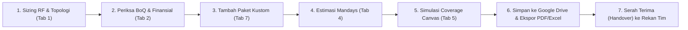
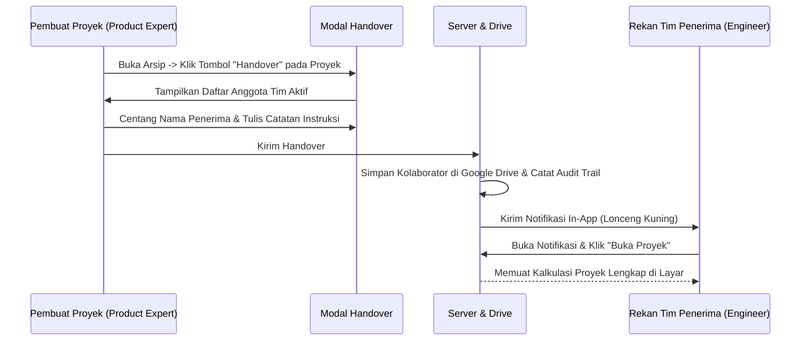

# Panduan Pengguna Resmi (User Guide)
## CDPK System Planner — Versi 8.4.0

> **Sistem:** CDPK System Planner *(Solution Sizing, RF Simulation, Commercial Suite & Enterprise Team Collaboration)*  
> **Distributor Resmi:** PT Citradata Purnakharisma (CDPK) — Authorized Distributor Motorola Solutions & Avigilon  
> **Akses Web Produksi:** [https://cdpk-system-planner.onrender.com/](https://cdpk-system-planner.onrender.com/)  
> **Bahasa:** Dwi-Bahasa (**🇮🇩 Bahasa Indonesia** & **🇬🇧 English**)  

---

## Daftar Isi
1. [Akses Sistem & Panduan Masuk (Login)](#1-akses-sistem--panduan-masuk-login)
2. [Tingkatan Peran Pengguna (User Roles & Access Levels)](#2-tingkatan-peran-pengguna-user-roles--access-levels)
3. [Alur Kerja Rekayasa & Penawaran (End-to-End Workflow)](#3-alur-kerja-rekayasa--penawaran-end-to-end-workflow)
4. [Panduan Modul 1: Sizing RF & Penentuan Topologi](#4-panduan-modul-1-sizing-rf--penentuan-topologi)
5. [Panduan Modul 2: BoQ & Konfigurasi Finansial](#5-panduan-modul-2-boq--konfigurasi-finansial)
6. [Panduan Modul 3: Katalog Produk & Spesifikasi](#6-panduan-modul-3-katalog-produk--spesifikasi)
7. [Panduan Modul 4: Estimasi Jasa & Mandays (Metode WES)](#7-panduan-modul-4-estimasi-jasa--mandays-metode-wes)
8. [Panduan Modul 5: Simulasi Propagasi Canvas RF](#8-panduan-modul-5-simulasi-propagasi-canvas-rf)
9. [Panduan Modul 6: Multi-Model AI Copilot](#9-panduan-modul-6-multi-model-ai-copilot)
10. [Panduan Modul 7: Kalkulator Produk & Sistem Kustom](#10-panduan-modul-7-kalkulator-produk--sistem-kustom)
11. [Kolaborasi Tim & Fitur Handover Proyek](#11-kolaborasi-tim--fitur-handover-proyek)
12. [Pusat Notifikasi & Serah Terima Tugas](#12-pusat-notifikasi--serah-terima-tugas)
13. [Penyimpanan Cloud & Dashboard Arsip Google Drive](#13-penyimpanan-cloud--dashboard-arsip-google-drive)
14. [Panduan Khusus Eksekutif (Administrator & Overseer)](#14-panduan-khusus-eksekutif-administrator--overseer)
    - [Ringkasan Portofolio Eksekutif](#ringkasan-portofolio-eksekutif)
    - [Kebijakan Guardrail Margin (< 15%)](#kebijakan-guardrail-margin--15)
    - [Jejak Audit Aktivitas (Audit Trail)](#jejak-audit-aktivitas-audit-trail)
15. [Penggunaan pada Smartphone & Tablet](#15-penggunaan-pada-smartphone--tablet)

---

## 1. Akses Sistem & Panduan Masuk (Login)

### 1.1. Alamat Resmi Aplikasi
Buka peramban (*web browser*) Anda ke: **[https://cdpk-system-planner.onrender.com/](https://cdpk-system-planner.onrender.com/)**

> [!IMPORTANT]
> Halaman depan aplikasi diproteksi secara ketat. Sebelum berhasil masuk (*login*), seluruh lembar kalkulator dan data proyek terisolasi dan tidak dapat diakses publik.

### 1.2. Opsi Masuk (Login)
1. **Jalur Utama: Masuk / Daftar 1-Klik dengan Google Workspace:**
   - Klik tombol **"Masuk / Daftar dengan Google Workspace"**.
   - Pilih akun email resmi perusahaan Anda:
     - `@citradata.id` (Karyawan PT Citradata Purnakharisma)
     - `@techsolutions.id` (Tim Engineering & Mitra Resmi)
   - *Keunggulan:* Tidak memerlukan password manual, terenkripsi penuh oleh Google Identity Services.
   - *Catatan:* Email publik seperti `@gmail.com` atau domain di luar whitelist akan ditolak otomatis oleh sistem keamanan.
2. **Jalur Sekunder: Masuk dengan Kredensial Khusus (Username & Password):**
   - Khusus akun lokal yang didaftarkan secara manual oleh Administrator.
   - Masukkan *Username / Email* dan *Password*, lalu klik **"Masuk dengan Password"**.

### 1.3. Pendaftaran Pengguna Baru & Penetapan Role oleh Admin
Sistem menyediakan dua jalur orientasi anggota tim baru:
1. **Jalur Rekomendasi: Pre-Provisioning oleh Admin (Tanpa Password)**
   - Administrator mendaftarkan email resmi karyawan (`@citradata.id` / `@techsolutions.id`) dan langsung menetapkan perannya melalui panel *Kelola Pengguna Tim*.
   - Password manual tidak diperlukan. Status akun langsung **`🟢 Aktif`**.
   - Ketika karyawan tersebut login pertama kali via Google Workspace SSO, sistem langsung mengenali emailnya dan memberikan akses instan tanpa menunggu approval.
2. **Jalur Registrasi Mandiri (Self-Initiated Google SSO):**
   - Karyawan baru yang langsung menekan tombol Google Workspace SSO akan dicatat dalam antrean **`⏳ Pending Approval`**.
   - Administrator menerima notifikasi verifikasi pendaftar baru dan dapat **memilih peran yang diinginkan** (*Product Expert, Engineer / Technician, Overseer, atau Administrator*) langsung pada menu verifikasi sebelum menekan tombol **"Setujui & Aktifkan"**.
   - *Tips:* Pengguna baru yang memerlukan percepatan aktivasi akun cukup hubungi Admin.

### 1.4. Keamanan Kredensial Khusus & Manajemen Password Mandiri
Untuk menjamin keamanan tingkat enterprise, sistem menerapkan standar kriptografi ketat:
- **Lokasi & Enkripsi Kredensial:** Data akun disimpan pada server lokal (`data/users.json`) dan disinkronkan ke tab cloud `Team_Users` pada Master Google Sheet. Password asli **TIDAK PERNAH DISIMPAN DALAM TEKS BIASA (*plaintext*)**. Seluruh password dienkripsi menggunakan algoritma standar militer **PBKDF2-HMAC-SHA256 (100.000 putaran kalkulasi)** dengan *cryptographic salt* 128-bit unik untuk setiap akun.
- **Penyensoran Google Sheets:** Pada Google Sheet tab `Team_Users`, kolom Password (F) disamarkan penuh dengan karakter `●●●●●●●●`. Hanya nilai hash terenkripsi dan salt unik yang disimpan.
- **Fitur Ganti Password Mandiri:** Pengguna yang masuk (termasuk Administrator) dapat mengganti password kapan saja secara instan melalui tombol **"🔑 Ganti Password"** di bar navigasi atas.
- **Fitur Reset Password oleh Admin:** Administrator dapat mereset password anggota tim mana pun langsung melalui panel *Kelola Tim*.

### 1.5. Dukungan Dwibahasa Penuh (Full Bilingual Support ID/EN)
Aplikasi mendukung peralihan bahasa instan antara **Bahasa Indonesia (ID)** dan **English (EN)** melalui toggle di pojok kanan atas:
- **Cakupan Dwibahasa:** Seluruh elemen aplikasi, mulai dari formulir login, navigasi, kalkulator sizing, BoQ komersial, simulasi RF & GIS heatmap, katalog produk, modul configurator mandiri, dialog kirim email, hingga panduan pengguna interaktif, merespons perubahan bahasa secara *real-time*.

---

## 2. Tingkatan Peran Pengguna (User Roles & Access Levels)

Sistem membedakan hak akses berdasarkan 4 peran resmi:

| Peran | Simbol | Deskripsi & Hak Akses | Akses Folder Master Cloud |
| :--- | :---: | :--- | :---: |
| **Administrator** | 👑 | Pemilik sistem dengan akses mutlak: mengelola seluruh akun tim, menyetujui pendaftaran, membuka link folder master Google Drive & Google Sheet pricelist, serta meninjau seluruh arsip proyek, audit trail, dan portofolio. | **YA** (Akses Penuh) |
| **Overseer** | 👁️ | Pemantau & Peninjau Eksekutif (Direksi, GM, Head of Department). Dapat melihat seluruh akun tim (*view-only*), membuka seluruh arsip proyek tim, meninjau jejak audit (*audit trail*), dan memantau kepatuhan margin eksekutif. | **TIDAK** (Folder & Sheet Master disembunyikan) |
| **Engineer / Technician** | 🛠️ | Tim teknis & presales rekayasa sistem. Fokus pada kalkulasi RF, topologi repeater, node DAS, estimasi mandays jasa, kustomisasi BoQ, penyimpanan berkas, dan penerimaan handover dari sales. | **TIDAK** (Hanya arsip sendiri / yang dibagikan) |
| **Product Expert** | 💼 | Tim penjualan & konsultan produk komersial. Fokus pada perakitan paket produk, optimasi harga penawaran klien, pengaturan diskon/margin, ekspor proposal, dan handover ke presales. | **TIDAK** (Hanya arsip sendiri / yang dibagikan) |

---

## 3. Alur Kerja Rekayasa & Penawaran (End-to-End Workflow)

---

## 4. Panduan Modul 1: Sizing RF & Penentuan Topologi

1. **Parameter Lingkungan & Industri:**
   - **Jenis Industri:** Pilih profil industri (Pertambangan, Minyak & Gas, Perkebunan Kelapa Sawit, Manufaktur, Pelabuhan, Rumah Sakit, dll.).
   - **Luas Area Cakupan:** Masukkan angka luas area operasional dalam satuan **km²** atau **Hektar (Ha)**.
   - **Kontur Medan (Terrain):** Pilih medan (*Flat, Rolling Hills, Mountainous, Dense Forest, Indoor Building*).
2. **Kebutuhan Pengguna & Fitur Khusus:**
   - **Jumlah Pengguna Radio Aktif (Users):** Masukkan estimasi total unit radio yang digunakan.
   - **Tinggi Tower Utama:** Tinggi antena repeater (standar 30–60 meter).
   - **Fitur Kritis:** Centang kebutuhan *ATEX Intrinsically Safe*, *Enkripsi Tingkat Tinggi (AES-256)*, *GPS Tracking*, *Man Down / Lone Worker*, dan *Integrasi Dispatcher Console*.
3. **Hasil Rekomendasi Otomatis:**
   - **Topologi:** Sistem otomatis memilihkan topologi optimal (*Conventional, IP Site Connect, atau Capacity Plus Trunking*).
   - **Repeater Base Station:** Menentukan jumlah site outdoor dan jumlah unit repeater standar 50W (**MOTOTRBO SLR 5300**).
   - **In-Building DAS Node:** Menghitung jumlah node penguat sinyal indoor kompak (**MOTOTRBO SLR 1000**).
   - **Alokasi Radio:** Membagi kuantitas radio HT (85%), radio kendaraan Mobile (10%), dan radio supervisor (5%).
   - **Daya & UPS:** Merekomendasikan kapasitas UPS (*VA*) dan kapasitas bank baterai (*Ah*) untuk ketahanan operasional sesuai jam backup yang dipilih.
4. **Fitur Reset Isian (Mulai Baru):**
   - Jika Anda ingin memulai rancangan kalkulasi baru atau mengembalikan parameter yang telah diubah ke konfigurasi standar, klik tombol **`🔄 Reset Isian`** pada bagian atas kartu *Parameter Teknis & Lingkungan Operasi* (di samping tombol *'✨ Isi dengan AI'*).
   - Seluruh isian teknis akan dikembalikan secara bersih ke konfigurasi baseline default awal, dan sistem secara otomatis memperbarui rekomendasi topologi, BoQ, serta simulasi propagasi.

---

## 5. Panduan Modul 2: BoQ & Konfigurasi Finansial

1. **Pilihan Mata Uang & Kurs:**
   - Pilih penawaran dalam **IDR (Rupiah)** atau **USD (Dollar)**.
   - Masukkan kurs konversi (default `Rp 16.200 / USD`).
2. **Target Margin Komersial & Kebijakan Guardrail:**
   - Masukkan persentase target margin penawaran.
   - **Peringatan Guardrail Margin:** Jika margin diatur di bawah **15.0%**, sistem akan memunculkan peringatan oranye `⚠️ Guardrail Margin Rendah (<15%)`. Proyek dengan margin rendah memerlukan persetujuan khusus Administrator / Overseer.
3. **Diskon & Pajak (PPN):**
   - Masukkan diskon komersial global jika ada (0–50%).
   - Pilih tarif PPN: **11%**, **12%**, atau **0% (Non-PKP / Bebas Pajak)**.
4. **Pilihan Mode Ekspor Dokumen:**
   - **Mode Technical BoQ:** Mencetak dokumen spesifikasi perangkat dan kuantitas rapi tanpa mencantumkan harga (untuk lampiran teknis tender).
   - **Mode Commercial Quotation:** Mencetak penawaran harga lengkap resmi beserta subtotal, diskon, PPN, dan grand total investasi.

---

## 6. Panduan Modul 3: Katalog Produk & Spesifikasi

- Menampilkan daftar produk resmi Motorola Solutions dan sistem keamanan Avigilon.
- Dilengkapi fitur **Pencarian Cerdas (Smart Search)** berdasarkan SKU, nama model, atau kata kunci (misal: `"ATEX"`, `"SLR5300"`, `"R7"`, `"IMPRES"`).
- Filter kategori cepat: *Repeater, Portable Radio (HT), Mobile Radio, Accessories, Dispatcher & Software, serta Video Security*.

---

## 7. Panduan Modul 4: Estimasi Jasa & Mandays (Metode WES)

- Menghitung hari kerja teknisi (*Work Breakdown Structure — Presales WES*):
  1. *Site Survey & Radio Propagation Testing*
  2. *Tower & Antenna Rigging Installation*
  3. *Repeater Programming & Duplexer Cavity Tuning*
  4. *Terminal Radio Programming & Fleetmap Alignment*
  5. *Dispatcher Console & Server Integration*
  6. *User Training, Testing, & Final Handover Commissioning*
- Pengguna dapat memilih tingkat kesulitan medan (*Low, Medium, High*) dan ukuran tim engineering.
- Hasil mandays otomatis dikalikan dengan tarif standar (`Rp 3.500.000 / Manday`) dan terintegrasi ke BoQ.

---

## 8. Panduan Modul 5: Simulasi Propagasi Canvas RF

- Menggambarkan visualisasi jangkauan radio pada peta interaktif.
- Atur parameter: Daya pancar Tx (Watt), gain antena (dBi), redaman kabel (dB), dan koordinat lokasi.
- Hasil simulasi memetakan area sinyal prima (*Strong Coverage*), area sinyal cukup (*Fair*), dan area potensi blind spot (*Dead Zones*).
- Tombol **"Ekspor Peta PNG"** mencetak gambar simulasi beresolusi tinggi untuk dokumen proposal.

---

## 9. Panduan Modul 6: Multi-Model AI Copilot

Dilengkapi pemilih model AI resmi Google Gemini:
- **Google Gemini 3.8 Flash:** Untuk kalkulasi kilat, konversi deskripsi proyek menjadi sizing instan, dan asistensi cepat.
- **Google Gemini 3.8 Pro:** Untuk analisis mendalam tender RKS yang rumit, penyusunan narasi metodologi teknis proposal resmi, serta optimalisasi anggaran ketat.

---

## 10. Panduan Modul 7: Kalkulator Produk & Sistem Kustom

### 10.1. Paket Sistem Siap Pakai (Pre-configured Bundles)
- **Paket Repeater Base Station SLR 5300:** Termasuk repeater, duplexer cavity, antena omni, feeder 7/8", lightning arrester, rack cabinet 19", dan UPS.
- **Paket Terminal Radio Portabel (R7 / P6620i):** Termasuk radio, baterai cadangan IMPRES, charger 6-gang, dan remote mic RSM.

### 10.2. Konfigurator Kustom (Custom Package Builder)
1. **Pilih Produk Utama:** Cari produk di dropdown (misal: *SLR 5300* atau *Motorola R7*).
2. **Kategori Lisensi (Licenses):**
   - Klik **"+ Tambah Lisensi"** untuk memilih lisensi yang sesuai dengan produk tersebut (misal: *IP Site Connect License*, *AES-256 Encryption*, *Capacity Plus*).
3. **Kategori Aksesoris (Accessories):**
   - Klik **"+ Tambah Aksesoris"** untuk melengkapi aksesoris resmi (baterai, charger, antena cadangan, mic RSM).
4. **Margin Kustom:** Sesuaikan slider margin paket kustom. Sistem akan mengingatkan jika margin di bawah ambang guardrail $15\%$.
5. **Transfer ke BoQ:** Klik **"Transfer Semua ke BoQ Proyek"** untuk memasukkan paket rakitan Anda ke tabel penawaran utama.

---

## 11. Kolaborasi Tim & Fitur Handover Proyek

Fitur serah terima proyek resmi memudahkan kerja sama antardivisi (misal: Product Expert menyerahkan rancangan awal ke Engineer untuk divalidasi):

### Langkah Melakukan Handover:
1. Klik tombol **"📂 Arsip Proyek Tim"** di bilah navigasi atas.
2. Cari proyek yang ingin diserahkan.
3. Klik tombol **"🤝 Handover"** pada baris proyek terkait.
4. Pilih 1 atau beberapa rekan tim aktif yang ingin ditugaskan.
5. Tuliskan catatan instruksi kerja pada kolom memo (opsional).
6. Klik **"Kirim Handover Proyek"**. Rekan tim penerima akan langsung menerima notifikasi di akun mereka.

---

## 12. Pusat Notifikasi & Serah Terima Tugas

- Terletak di bilah atas aplikasi dengan simbol **Lonceng Kuning** (🔔).
- Badge angka merah menunjukkan jumlah pemberitahuan belum dibaca (*unread*).
- Klik lonceng untuk membuka drawer notifikasi.
- Notifikasi serah terima proyek dilengkapi tombol pintas **"⚡ Buka Proyek"** untuk langsung memuat data kalkulasi ke layar kerja Anda tanpa perlu mencari di arsip Drive.

---

## 13. Penyimpanan Cloud & Dashboard Arsip Google Drive

### 13.1. Menyimpan Proyek ke Cloud
- Klik tombol **"💾 Simpan ke Drive"** di bilah atas aplikasi.
- Sistem mengunggah dua berkas secara otomatis ke subfolder Google Drive tim:
  1. **Berkas Data JSON (`.cdpk.json`):** Berisi data kalkulasi menyeluruh agar proyek dapat dimuat dan disunting kembali kapan saja.
  2. **Lembar Kerja Excel (`.xlsx`):** Berisi ringkasan proyek dan tabel penawaran komersial BoQ multi-sheet resmi berformat profesional.

### 13.2. Memuat Kembali Proyek yang Disimpan
- Buka menu **"📂 Arsip Proyek Tim"**.
- Cari nama proyek atau nama klien.
- Klik tombol **"⚡ Buka Proyek"** pada berkas yang diinginkan.
- Seluruh input sizing, konfigurasi BoQ, dan parameter kalkulasi akan dipulihkan secara instan.

---

## 14. Panduan Khusus Eksekutif (Administrator & Overseer)

Bagi pengguna dengan peran **Administrator (👑)** dan **Overseer (👁️)**, dashboard arsip dilengkapi dengan modul pengawasan tingkat lanjut:

### Ringkasan Portofolio Eksekutif
Terletak di bagian atas modal Arsip Proyek, menampilkan 4 metrik finansial real-time:
1. **Total Pipeline Nilai Proyek:** Akumulasi total nilai investasi seluruh dokumen proyek aktif tim (format Rupiah IDR).
2. **Rata-rata Margin Tim:** Indikator persentase margin rata-rata dari seluruh penawaran yang dibuat.
3. **Kepatuhan Guardrail ($\ge 15\%$):** Jumlah proyek yang memenuhi batas profitabilitas standar perusahaan.
4. **Perlu Perhatian Margin ($< 15\%$):** Menampilkan jumlah proyek dengan margin rendah yang memerlukan evaluasi khusus.

### Kebijakan Guardrail Margin (< 15%)
- Standar perusahaan menetapkan batas minimum margin penawaran adalah **15.0%**.
- Setiap berkas kalkulasi di arsip akan diberi lencana visual:
  - `✓ Margin: 20.0%` (Hijau / Patuh)
  - `⚠️ Margin: 12.0% (<15%)` (Oranye / Peringatan)

### Jejak Audit Aktivitas (Audit Trail)
- Klik tab **"📜 Jejak Audit Aktivitas"** di dalam modal arsip.
- Fitur ini menyajikan catatan kejadian (*tamper-evident immutable log*) meliputi:
  - Waktu kejadian (stempel waktu UTC)
  - Nama dan username pelaku
  - Peran pelaku (Administrator, Overseer, Engineer / Technician, Product Expert)
  - Kategori aksi (*Login, Simpan Proyek, Buka Proyek, Handover, Ekspor PDF, Ekspor Excel, Kelola Pengguna*)
  - Rincian aktivitas & alamat IP

---

## 15. Penggunaan pada Smartphone & Tablet (PWA & Versi Mobile)

CDPK System Planner dioptimalkan secara penuh untuk survei lapangan menggunakan perangkat bergerak:
- **Progressive Web App (PWA):** Dapat dipasang langsung ke layar utama HP tanpa melalui App Store / Play Store dan berjalan dalam mode *standalone* layar penuh tanpa bilah URL browser.
- **Cara Pasang di Android:**
  - Buka `https://cdpk-system-planner.onrender.com` di Google Chrome.
  - Ketuk tombol **"📲 Pasang CDPK Planner di HP"** di menu atau ketuk pop-up *Install App* yang muncul di bilah browser.
- **Cara Pasang di iPhone & iPad:**
  - Buka tautan sistem di browser **Safari**.
  - Ketuk tombol **Bagikan (Share)** ⎋ di bilah navigasi bawah Safari.
  - Gulir ke bawah dan ketuk opsi **"Tambah ke Layar Utama" (Add to Home Screen)** ➕.
  - Ketuk **"Tambah"** di sudut kanan atas. Ikon resmi CDPK Planner akan muncul di layar utama iOS Anda.
- **Dukungan Multi-Akun Google:**
  - Jika browser HP terhubung ke beberapa akun Google (pribadi dan kerja), gunakan tombol **"🔄 Pilih / Ganti Akun Google Lain"** di halaman login untuk memilih akun resmi perusahaan (`@citradata.id` atau `@techsolutions.id`).
- **Navigasi Bawah Ramah Jempol (Bottom Navigation Bar):**
  - Pada layar smartphone, navigasi utama dipindahkan ke bilah bawah: 📐 **Sizing**, 📋 **BoQ**, 🗺️ **Peta GIS**, ✨ **AI Copilot**, dan 📂 **Menu**.
- **Deteksi GPS Satelit Lapangan:**
  - Modul deteksi GPS memanfaatkan antena satelit perangkat dengan opsi presisi tinggi (*high accuracy*) dan pelaporan toleransi akurasi seketika.

---

*CDPK System Planner v8.4.1 — Solusi Rekayasa Komunikasi Radio Motorola Solutions & Keamanan Avigilon.*
